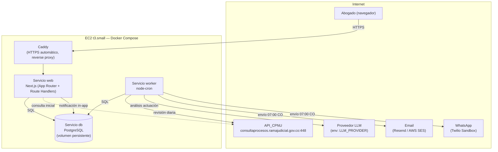
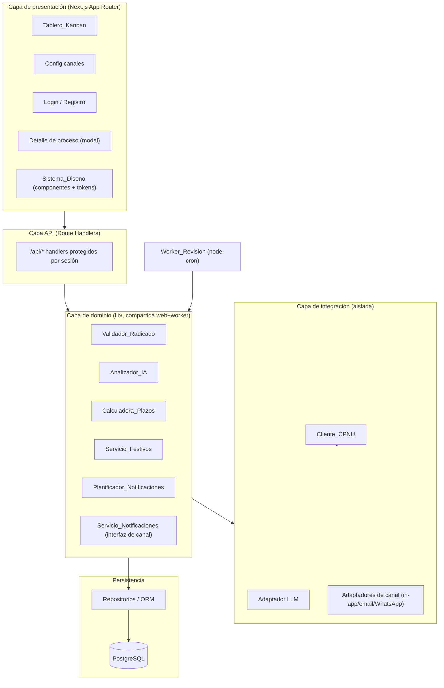
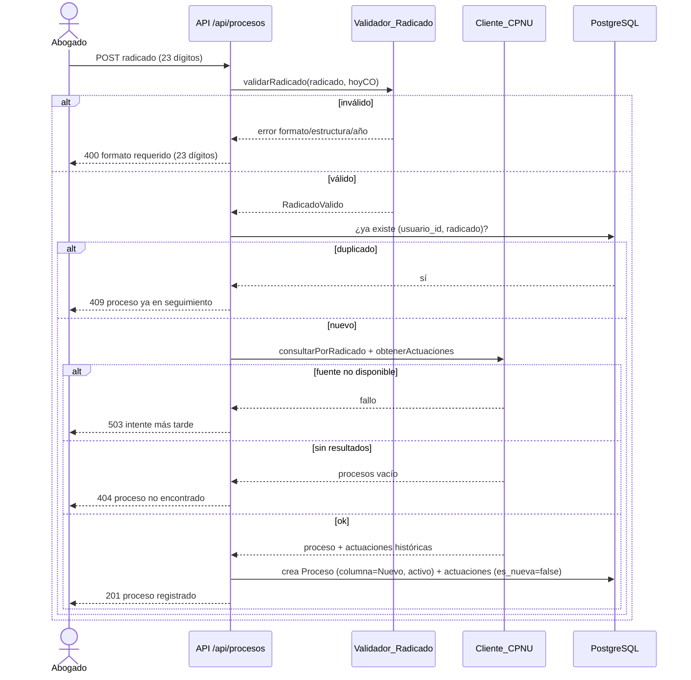
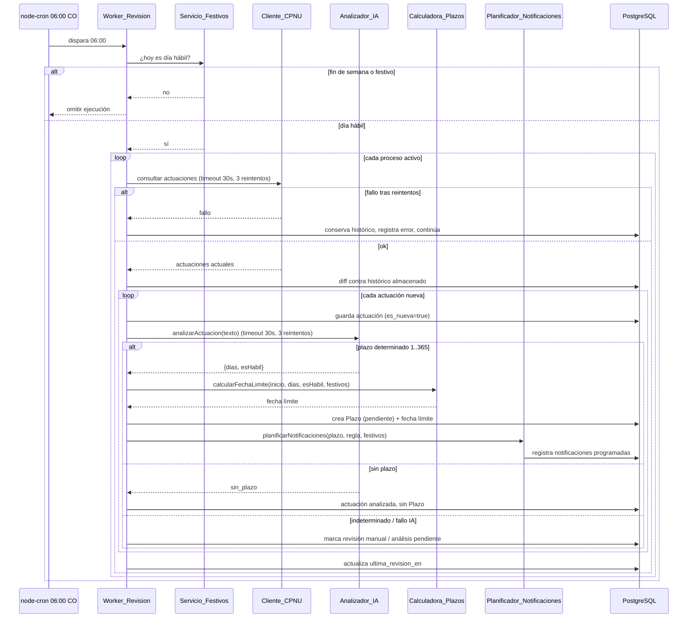
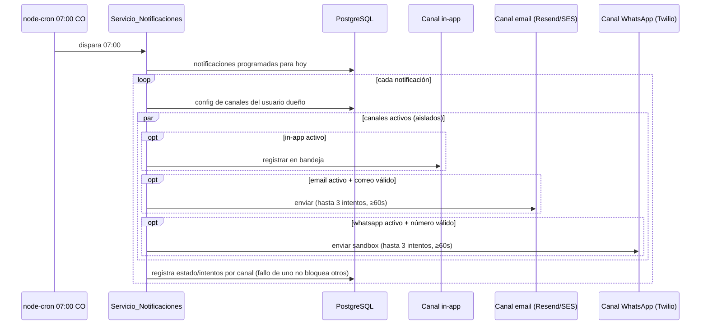

# Documento de Diseño — LexAI MVP

## Alcance geográfico (recordatorio vinculante)

Este diseño es **exclusivamente para el sistema judicial de Colombia**. La única fuente de datos es la Consulta de Procesos Nacional Unificada (CPNU) de la Rama Judicial de Colombia. No se abstrae la fuente de datos por país, no se hace configurable la jurisdicción, ni se generaliza el identificador de proceso, el cálculo de días hábiles/festivos, la terminología procesal del prompt de IA, la moneda, el idioma, el formato de fecha ni la zona horaria. Cualquier extensión multi-país queda fuera de alcance total.

## Overview

LexAI es una plataforma SaaS de trazabilidad procesal para abogados independientes en Colombia. El abogado registra un proceso por su número de radicado de 23 dígitos una sola vez; el sistema lo revisa automáticamente cada día hábil colombiano, detecta actuaciones nuevas contra la CPNU, las analiza con un LLM para identificar plazos procesales, calcula la fecha límite en días hábiles colombianos, programa y envía notificaciones (in-app, email, WhatsApp) el día calendario anterior a cada día hábil restante, y presenta todo en un tablero Kanban de cinco columnas.

### Objetivos del MVP (Fase 1)

- Autenticación real (registro, inicio/cierre de sesión, bloqueo por intentos, expiración por inactividad).
- Registro de procesos por radicado con validación de estructura de 23 dígitos.
- Cliente CPNU aislado con rate limiting, timeout, reintentos y paginación.
- Worker de revisión diaria (cron) en días hábiles a las 06:00 America/Bogotá.
- Análisis IA de actuaciones con proveedor LLM intercambiable por variable de entorno.
- Cálculo de plazos en días hábiles colombianos (festivos Ley 51 de 1983).
- Programación y envío de notificaciones a las 07:00 America/Bogotá por canales configurables.
- Módulo de configuración de canales.
- Tablero Kanban como pantalla principal con aislamiento de datos por usuario.
- Sistema de diseño neumórfico accesible (WCAG 2.1 AA) y logo LexAI construidos desde el día 1.
- Placeholders de módulos en standby (tutelas, redacción IA).
- Localización colombiana fija (es-CO, DD/MM/AAAA, HH:MM 24h, UTC-5, COP).
- Modelo de datos preparado para extenderse a Despacho (tenant) y Rol en Fase 2 sin refactor de tablas núcleo.

### Restricciones de contexto (hackatón)

Entrega en 5 días con 3 personas; los 2 últimos días son exclusivos de despliegue, por lo que el desarrollo funcional real es de 3 días. Las decisiones priorizan simplicidad y velocidad: monolito full-stack en TypeScript, una sola base de datos relacional, un solo servidor con Docker Compose. El diseño y la accesibilidad no se sacrifican por velocidad (requerimiento explícito del PRD).

### Decisiones de diseño clave y su justificación

- **Monolito Next.js full-stack (App Router) en TypeScript**: un solo lenguaje y repo elimina fricción de integración entre frontend y backend para un equipo pequeño con poco tiempo. Se descarta dividir en Python/Java.
- **Worker como proceso separado (mismo repo/lenguaje)**: el cron de revisión diaria corre como contenedor `worker` independiente para no acoplarlo al ciclo de vida de las peticiones web, pero comparte el código de dominio (cliente CPNU, análisis, cálculo).
- **PostgreSQL**: encaja natural con las relaciones Usuario → Proceso → Actuacion → Plazo.
- **Cliente CPNU aislado** (`lib/cpnu-client.ts`): confina toda comunicación con la API de la Rama Judicial en una capa reemplazable, dado que es una API no documentada que puede cambiar.
- **LLM intercambiable por variable de entorno**: evita acoplar el sistema a un proveedor y permite usar tiers gratuitos (Gemini/Claude) sin cambios de código.
- **Regla de notificación parametrizada**: la regla "avisar el día calendario anterior a cada día hábil restante" vive en configuración, no hardcodeada, para poder ajustarla después.
- **Despliegue en un solo EC2 t3.small con Docker Compose + Caddy**: la ruta más corta a producción sin curva de aprendizaje de AWS para un equipo sin experiencia.

## Architecture

### Vista de despliegue (un solo EC2 t3.small)



Servicios de `docker-compose.yml`: `web` (Next.js), `db` (PostgreSQL con volumen persistente), `worker` (cron). Secretos vía archivo `.env` no versionado: `DATABASE_URL`, `LLM_PROVIDER`, `LLM_API_KEY`, credenciales de Twilio/Resend (o AWS SES), `NEXTAUTH_SECRET`. Despliegue con `deploy.sh` (git pull + `docker compose up -d --build`).

### Vista lógica de capas



La capa de dominio (`lib/`) es compartida entre el servicio `web` y el `worker`, de modo que la lógica pura (validación, cálculo, planificación, diffing) se prueba y reutiliza en ambos contextos.

## Components and Interfaces

### Servicio_Autenticacion

Basado en NextAuth.js/Auth.js con proveedor de credenciales (email + contraseña). Responsabilidades:

- Registro: valida nombre (1–100), email (formato válido, ≤254), contraseña (8–128), verifica unicidad de email, almacena `password_hash` (bcrypt/argon2), crea `Usuario` y su `ConfiguracionUsuario` por defecto (in-app activo; email y WhatsApp inactivos). (R1)
- Login: valida credenciales, crea sesión, redirige al Kanban; mensaje genérico ante fallo sin revelar el campo. (R2.1, R2.2)
- Protección de rutas: middleware que restringe Kanban, registro de procesos y configuración a sesiones autenticadas. (R2.3)
- Cierre de sesión: invalida la sesión. (R2.4)
- Bloqueo temporal: 5 intentos fallidos en ventana de 15 minutos bloquea nuevos intentos para ese correo. Se registra por email en tabla `IntentoLogin` (o contador con marca de tiempo). (R2.5)
- Expiración por inactividad: sesión expira tras 30 minutos sin actividad (sliding expiration en la config de sesión). (R2.6)

Interfaz (conceptual):

```typescript
registrarUsuario(input: { nombre: string; email: string; password: string }): Promise<Result<UsuarioPublico, ErrorRegistro>>
autenticar(input: { email: string; password: string }): Promise<Result<Sesion, ErrorLogin>>
cerrarSesion(sesionId: string): Promise<void>
```

### Validador_Radicado

Función pura que valida la estructura del radicado de 23 dígitos. (R3)

- Acepta solo si son exactamente 23 caracteres, todos dígitos 0–9, sin espacios ni separadores. (R3.1, R3.2)
- Interpreta estructura de izquierda a derecha: 5 (DANE municipio) + 2 (entidad) + 2 (especialidad) + 3 (despacho) + 4 (año) + 7 (consecutivo) = 23. (R3.3)
- Rechaza si el año (dígitos 13–16) es < 1900 o > año calendario actual (en America/Bogotá). (R3.4)

```typescript
type RadicadoValido = { raw: string; dane: string; entidad: string; especialidad: string; despacho: string; anio: number; consecutivo: string }
validarRadicado(input: string, hoy: Date): Result<RadicadoValido, ErrorRadicado>
```

### Cliente_CPNU (`lib/cpnu-client.ts`)

Capa de integración aislada; único punto de comunicación con la API_CPNU. (R4, R4.9)

- Endpoint de consulta por radicado **confirmado**: `GET https://consultaprocesos.ramajudicial.gov.co:448/api/v2/Procesos/Consulta/NumeroRadicacion` con query params `numero`, `SoloActivos`, `pagina`. (R4.1)
- Endpoint de **detalle de actuaciones** por `idProceso`: **PENDIENTE de confirmación** (tarea del día 1). Se implementa detrás de la misma capa aislada (`obtenerActuaciones(idProceso)`) para poder ajustarlo sin tocar la lógica de negocio. Hasta confirmarlo, el contrato queda definido y mockeable.
- No consulta si el radicado no fue aceptado por el Validador_Radicado. (R4.2)
- Headers en cada petición: `Accept: application/json, text/plain, */*`, `Referer: https://consultaprocesos.ramajudicial.gov.co/`, `User-Agent` de navegador estándar. (R4.3)
- Rate limit: máximo 2 peticiones/segundo, sin ráfagas (cola con espaciado mínimo de 500 ms entre peticiones). (R4.4)
- Timeout: 30 s por petición. (R4.5)
- Paginación: inicia `pagina` en 1 e incrementa secuencialmente respetando el rate limit, hasta 100 páginas máximo por consulta. (R4.6)
- Reintentos: hasta 3 por petición; agotados, registra el error y devuelve fallo sin interrumpir otros procesos. (R4.7)
- Extracción por elemento de `procesos[]`: `idProceso`, `llaveProceso`, `despacho`, `departamento`, `sujetosProcesales` (demandante y demandado), `fechaUltimaActuacion`. (R4.8)

```typescript
interface ClienteCPNU {
  consultarPorRadicado(radicado: RadicadoValido, opts?: { soloActivos?: boolean }): Promise<Result<ProcesoCPNU[], FalloCPNU>>
  obtenerActuaciones(idProceso: string): Promise<Result<ActuacionCPNU[], FalloCPNU>> // endpoint PENDIENTE, aislado
}
type FalloCPNU = { tipo: "radicado_invalido" | "no_encontrado" | "fuente_no_disponible" | "error"; detalle: string }
```

### Worker_Revision

Proceso `node-cron` en el contenedor `worker`. (R6)

- Programación: cron a las 06:00 America/Bogotá (UTC-5). Antes de ejecutar, verifica que el día sea lunes–viernes y **no** festivo nacional según Servicio_Festivos; si es fin de semana o festivo, omite la ejecución. (R6.1, R6.2, R6.9)
- Para cada proceso activo: consulta CPNU (timeout 30 s), compara actuaciones obtenidas contra el histórico almacenado (diffing por identidad de actuación, sin filtrar por palabras clave). (R6.3, R6.4)
- Actuación nueva: la almacena marcada como nueva e inicia el análisis con Analizador_IA. (R6.5)
- Actualiza `ultima_revision_en` al finalizar cada proceso. (R6.6)
- Resiliencia: fallo de consulta → hasta 3 reintentos; agotados, conserva histórico sin cambios, registra error, continúa con los demás. Fallo de análisis IA → conserva la actuación nueva, continúa con los demás. (R6.7, R6.8)

### Analizador_IA

Envía el texto de la actuación al proveedor LLM configurado por `LLM_PROVIDER`/`LLM_API_KEY`. (R7)

- Timeout 30 s por solicitud; hasta 3 reintentos; agotados, registra error, conserva actuación con análisis pendiente, no bloquea otros procesos. (R7.1, R7.9)
- Determina si la actuación implica plazo a cargo del abogado. (R7.2)
- Si implica plazo determinado, extrae duración como entero 1–365 días. (R7.3)
- Clasifica el plazo como días hábiles por defecto, salvo que el texto indique explícitamente días calendario. (R7.4)
- Estrategia de prompt: redactado en terminología procesal colombiana (traslado, término de ejecutoria, días hábiles, subsanación, apelación), instruyendo por defecto días hábiles y salida estructurada (JSON) con `{ tienePlazo: boolean, dias: number|null, esHabil: boolean, indeterminado: boolean }`.
- Resultados:
  - Plazo determinado 1–365 → crea `Plazo` (pendiente, con `es_habil`). (R7.5)
  - Sin plazo → marca actuación analizada sin crear Plazo. (R7.6)
  - Plazo indeterminado o fuera de 1–365 → marca actuación analizada, plazo indeterminado, sin fecha límite, señalada para revisión manual. (R7.7)
- Proveedor intercambiable por env sin cambios de código (adaptador). (R7.8)

```typescript
type ResultadoIA =
  | { tipo: "sin_plazo" }
  | { tipo: "plazo"; dias: number /*1..365*/; esHabil: boolean }
  | { tipo: "indeterminado" }
analizarActuacion(texto: string): Promise<Result<ResultadoIA, FalloIA>>
```

### Calculadora_Plazos

Función pura de cálculo de fecha límite. (R8)

- Días hábiles: cuenta N días hábiles desde la fecha de inicio del Plazo, excluyendo sábados, domingos y festivos del Servicio_Festivos. (R8.1)
- Días calendario: cuenta N días consecutivos. (R8.2)
- Si N no es entero en 1–365, se abstiene y señala revisión manual. (R8.4)
- Si Servicio_Festivos no está disponible, se abstiene de almacenar fecha, registra error, señala reintento. (R8.5)
- Todos los cálculos en America/Bogotá (UTC-5) sin horario de verano. (R8.7)

```typescript
calcularFechaLimite(inicio: FechaCO, dias: number, esHabil: boolean, festivos: Set<string>): Result<FechaCO, ErrorCalculo>
```

### Servicio_Festivos

Tabla estática de festivos nacionales de Colombia conforme a la Ley 51 de 1983 (incluye traslado de festivos "Ley Emiliani" al lunes siguiente cuando aplica), para el año en curso y al menos los dos siguientes. (R8.3)

```typescript
esFestivo(fecha: FechaCO): boolean
festivosDelAnio(anio: number): FechaCO[]
```

### Planificador_Notificaciones

Determina las fechas calendario de notificación de un Plazo. (R9)

- Regla parametrizada (config): notificar el día calendario inmediatamente anterior a cada día hábil restante del plazo, a la hora configurada (por defecto 07:00) en America/Bogotá. (R9.1, R9.2, R9.4)
- Registra cada notificación programada (fecha y hora) en el Plazo. (R9.3)
- Si no queda ningún día hábil restante (vence hoy o ya venció), no programa notificaciones futuras y genera alerta inmediata. (R9.5)
- Si la programación falla, conserva el Plazo sin notificaciones parciales y registra indicador de error. (R9.6)

```typescript
type ReglaNotificacion = { horaEnvio: string /*HH:MM*/; anticipacion: "dia_calendario_anterior_a_cada_dia_habil" }
planificarNotificaciones(plazo: Plazo, regla: ReglaNotificacion, festivos: Set<string>, ahora: FechaCO): Result<NotificacionProgramada[], ErrorPlanificacion>
```

### Servicio_Notificaciones

Envía notificaciones por los canales activos a las 07:00 America/Bogotá cuando llega la fecha programada. (R10)

- Interfaz común de canal con aislamiento por canal y reintentos:

```typescript
interface CanalNotificacion {
  readonly nombre: "in_app" | "email" | "whatsapp"
  disponiblePara(config: ConfiguracionUsuario): boolean // valida datos requeridos (email/telefono)
  enviar(destino: Usuario, mensaje: MensajeNotificacion): Promise<Result<void, FalloCanal>>
}
```

- In-app activo → registra notificación para visualización en app. (R10.2)
- Email activo con correo válido → envía por email (Resend o AWS SES); sin correo válido → omite, registra error, continúa. (R10.3, R10.4)
- WhatsApp activo con número → envía por Twilio Sandbox; sin número → omite, registra error, continúa. (R10.5, R10.6)
- Fallo de envío por canal → hasta 3 reintentos separados ≥60 s; agotados → registra error y continúa con los demás canales sin bloquearlos. (R10.7, R10.8)
- Cada canal está aislado: el fallo de uno no afecta a otros.

### Tablero_Kanban

Pantalla principal tras login. (R12)

- Muestra solo procesos del usuario autenticado (aislamiento por `usuario_id`), en ≤3 s. (R12.1)
- Exactamente cinco columnas: Nuevo, En seguimiento, Requiere acción, Vencido, Archivado; cada proceso en una sola columna. (R12.2)
- Tarjeta muestra: radicado (23 dígitos), demandante y demandado, último estado/actuación, juzgado, departamento/ciudad. (R12.3)
- Detalle (modal): histórico completo de actuaciones ordenado de más reciente a más antiguo + plazos activos. (R12.4)
- Cuando un Plazo supera su fecha límite sin cumplirse (hora CO) → proceso a columna Vencido y Plazo marcado vencido. (R12.5)
- Sin procesos → cinco columnas vacías con mensaje. (R12.6)
- Drag-and-drop accesible con anuncios ARIA live (ver Accesibilidad). (R18.5)

### Sistema_Diseno

Librería de componentes reutilizables accesibles + tokens, construida desde el día 1 antes de las pantallas. (R16) Detalle en la sección "Design system & accessibility".

### Módulo de configuración

Gestión de canales de notificación. (R11)

- Muestra estado (activo/inactivo) de in-app, email, WhatsApp en ≤3 s. (R11.1)
- Persiste cambios con confirmación visible; si la persistencia falla, conserva estado previo y muestra error. (R11.2, R11.3)
- Activar WhatsApp requiere número internacional válido (8–15 dígitos con prefijo de país); sin número válido rechaza y mantiene inactivo. (R11.4, R11.5)
- Campo `frecuencia_revision` fijo (diaria en días hábiles), no editable en esta fase. (R11.6)
- Sin gestión de roles ni permisos. (R11.7)

## Data Models

Esquema PostgreSQL. Entidades núcleo de Fase 1: `usuario`, `proceso`, `actuacion`, `plazo`, `configuracion_usuario`. Convenciones: identificadores UUID (`uuid` con `gen_random_uuid()`), marcas de tiempo `timestamptz` almacenadas en UTC y renderizadas en America/Bogotá en la capa de presentación.

### Diagrama entidad-relación

```mermaid
erDiagram
  USUARIO ||--|| CONFIGURACION_USUARIO : tiene
  USUARIO ||--o{ PROCESO : posee
  PROCESO ||--o{ ACTUACION : contiene
  ACTUACION ||--o{ PLAZO : genera
  PLAZO ||--o{ NOTIFICACION : programa

  USUARIO {
    uuid id PK
    varchar nombre
    varchar email UK
    varchar password_hash
    timestamptz creado_en
  }
  CONFIGURACION_USUARIO {
    uuid usuario_id PK_FK
    boolean canal_inapp_activo
    boolean canal_email_activo
    boolean canal_whatsapp_activo
    varchar telefono_whatsapp
    varchar frecuencia_revision
  }
  PROCESO {
    uuid id PK
    uuid usuario_id FK
    char numero_radicado
    varchar id_proceso_cpnu
    varchar juzgado
    varchar departamento
    varchar ciudad
    varchar tipo_proceso
    jsonb partes_procesales
    varchar estado_actual
    varchar columna_kanban
    boolean seguimiento_activo
    timestamptz creado_en
    timestamptz ultima_revision_en
  }
  ACTUACION {
    uuid id PK
    uuid proceso_id FK
    varchar id_actuacion_cpnu
    date fecha_actuacion
    text texto
    boolean es_nueva
    varchar estado_analisis
    timestamptz detectada_en
  }
  PLAZO {
    uuid id PK
    uuid actuacion_id FK
    int dias_plazo
    boolean es_habil
    boolean indeterminado
    date fecha_inicio
    date fecha_limite_calculada
    varchar estado
    boolean requiere_revision_manual
    boolean error_programacion
    timestamptz creado_en
  }
  NOTIFICACION {
    uuid id PK
    uuid plazo_id FK
    timestamptz fecha_hora_programada
    varchar estado
    int intentos
    timestamptz enviada_en
  }
```

### Definiciones de tablas

**usuario** (R1)
- `id uuid PK`
- `nombre varchar(100) NOT NULL`
- `email varchar(254) NOT NULL` — índice único `ux_usuario_email`
- `password_hash varchar NOT NULL`
- `creado_en timestamptz NOT NULL DEFAULT now()`

**configuracion_usuario** (R1.6, R11)
- `usuario_id uuid PK/FK → usuario.id`
- `canal_inapp_activo boolean NOT NULL DEFAULT true`
- `canal_email_activo boolean NOT NULL DEFAULT false`
- `canal_whatsapp_activo boolean NOT NULL DEFAULT false`
- `telefono_whatsapp varchar(16) NULL`
- `frecuencia_revision varchar NOT NULL DEFAULT 'diaria_habiles'` — campo fijo, no editable en Fase 1 (R11.6)

**proceso** (R5, R12)
- `id uuid PK`
- `usuario_id uuid NOT NULL FK → usuario.id`
- `numero_radicado char(23) NOT NULL`
- `id_proceso_cpnu varchar NULL` — `idProceso` de la CPNU para consultar actuaciones
- `juzgado varchar NULL`, `departamento varchar NULL`, `ciudad varchar NULL`, `tipo_proceso varchar NULL`
- `partes_procesales jsonb NOT NULL` — `{ demandante: string, demandado: string }`
- `estado_actual varchar NULL`
- `columna_kanban varchar NOT NULL DEFAULT 'Nuevo'` — enum lógico: Nuevo, En seguimiento, Requiere acción, Vencido, Archivado (R12.2)
- `seguimiento_activo boolean NOT NULL DEFAULT true`
- `creado_en timestamptz NOT NULL DEFAULT now()`
- `ultima_revision_en timestamptz NULL`
- Índice único `ux_proceso_usuario_radicado (usuario_id, numero_radicado)` — evita duplicados por usuario (R5.6)
- Índice `ix_proceso_usuario (usuario_id)` — aislamiento y listado Kanban (R12.1)
- Índice `ix_proceso_activo (seguimiento_activo)` — barrido del worker (R6.1)

**actuacion** (R5.3, R6)
- `id uuid PK`
- `proceso_id uuid NOT NULL FK → proceso.id`
- `id_actuacion_cpnu varchar NOT NULL` — clave de identidad para el diffing
- `fecha_actuacion date NULL`
- `texto text NOT NULL`
- `es_nueva boolean NOT NULL DEFAULT true`
- `estado_analisis varchar NOT NULL DEFAULT 'pendiente'` — pendiente, analizada, sin_plazo, indeterminado, error
- `detectada_en timestamptz NOT NULL DEFAULT now()`
- Índice único `ux_actuacion_proceso_cpnu (proceso_id, id_actuacion_cpnu)` — garantiza identidad estable para el diffing (R6.4)

**plazo** (R7.5, R8, R9)
- `id uuid PK`
- `actuacion_id uuid NOT NULL FK → actuacion.id`
- `dias_plazo int NULL` — 1..365 cuando determinado
- `es_habil boolean NOT NULL DEFAULT true`
- `indeterminado boolean NOT NULL DEFAULT false`
- `fecha_inicio date NOT NULL`
- `fecha_limite_calculada date NULL`
- `estado varchar NOT NULL DEFAULT 'pendiente'` — pendiente, cumplido, vencido
- `requiere_revision_manual boolean NOT NULL DEFAULT false`
- `error_programacion boolean NOT NULL DEFAULT false`
- `creado_en timestamptz NOT NULL DEFAULT now()`
- Índice `ix_plazo_estado_fecha (estado, fecha_limite_calculada)` — detección de vencidos (R12.5)

**notificacion** (R9.3, R10)
- `id uuid PK`
- `plazo_id uuid NOT NULL FK → plazo.id`
- `fecha_hora_programada timestamptz NOT NULL`
- `estado varchar NOT NULL DEFAULT 'programada'` — programada, enviada, fallida
- `intentos int NOT NULL DEFAULT 0`
- `enviada_en timestamptz NULL`
- `canal varchar NULL` — in_app, email, whatsapp (registro por canal en el envío)
- Índice `ix_notificacion_programada (fecha_hora_programada, estado)` — barrido de envío a las 07:00 (R10.1)

> Nota: en el PRD, `Plazo.notificaciones_generadas` figura como JSON. Aquí se normaliza a la tabla `notificacion` para permitir el barrido eficiente por fecha/hora de envío y el registro de intentos por canal; el requisito R9.3 (registrar cada notificación en el registro del Plazo) se satisface por la relación `plazo (1) → (N) notificacion`.

**notificacion_inapp** (R10.2) — bandeja in-app del usuario
- `id uuid PK`, `usuario_id uuid FK`, `plazo_id uuid FK NULL`, `titulo varchar`, `cuerpo text`, `leida boolean DEFAULT false`, `creada_en timestamptz`

**intento_login** (R2.5) — control de bloqueo por email
- `id uuid PK`, `email varchar(254) NOT NULL`, `exitoso boolean`, `ocurrido_en timestamptz`
- Índice `ix_intento_email_tiempo (email, ocurrido_en)` — conteo en ventana de 15 minutos

### Enfoque de extensibilidad a Fase 2 (Despacho y Rol) — R13.5, R15

El modelo se diseña para que Fase 2 se incorpore **solo agregando entidades y relaciones**, sin eliminar ni renombrar tablas ni columnas núcleo:

- **Despacho (tenant)**: se añade una tabla `despacho (id, nombre, creado_en)` y una relación `usuario.despacho_id` **nullable** (o una tabla puente `despacho_usuario`). En Fase 1 el valor es nulo (un tenant implícito = un abogado). Ninguna consulta de Fase 1 filtra por despacho, por lo que agregar la columna nullable no altera la lógica existente. (R15.1)
- **Rol**: se añaden `rol (id, nombre)` y `usuario_rol (usuario_id, rol_id)` como tablas nuevas; no se toca `usuario`. (R15.2)
- **Módulos en standby (tutelas, redacción IA)**: sus futuras entidades (p. ej. `tutela`, `borrador_ia`) se agregan como tablas nuevas relacionadas por FK a `usuario`/`proceso` sin modificar columnas ni relaciones de las tablas núcleo. (R13.5)
- **Frecuencia de revisión configurable (Fase 2)**: el campo `configuracion_usuario.frecuencia_revision` ya existe; habilitarlo no requiere cambios de esquema. (R11.6)

En Fase 1 el sistema opera con un único tenant equivalente a un abogado independiente y sin aplicar lógica de multi-tenant ni de roles/permisos; toda operación que dependa de esa funcionalidad se rechaza conservando el estado de los datos y mostrando que no está disponible en Fase 1. (R15.3, R15.4)

## API surface (Next.js Route Handlers)

Todas las rutas bajo `/api` (excepto autenticación de registro/login) exigen sesión válida; el middleware redirige a login si no hay sesión (R2.3). Toda consulta de datos filtra por el `usuario_id` de la sesión — un usuario nunca ve datos de otro (R12.1).

| Método y ruta | Descripción | Protección | Requisitos |
|---|---|---|---|
| `POST /api/auth/register` | Registro de usuario; crea Usuario + ConfiguracionUsuario por defecto | Pública | R1 |
| `POST /api/auth/[...nextauth]` | Login/logout gestionado por Auth.js (credenciales) | Pública (login) | R2 |
| `POST /api/procesos` | Registra un proceso por radicado (valida → consulta CPNU → crea Proceso + histórico) | Sesión | R3, R4, R5 |
| `GET /api/procesos` | Lista/kanban de procesos del usuario, agrupados por `columna_kanban` | Sesión | R12.1–R12.3, R12.6 |
| `GET /api/procesos/:id` | Detalle: proceso + actuaciones (desc) + plazos activos | Sesión, dueño | R12.4 |
| `PATCH /api/procesos/:id` | Mueve de columna Kanban (drag-and-drop) | Sesión, dueño | R12.2 |
| `GET /api/configuracion` | Estado de canales | Sesión | R11.1 |
| `PATCH /api/configuracion` | Activa/desactiva canales; valida WhatsApp | Sesión | R11.2–R11.5 |
| `GET /api/notificaciones` | Bandeja in-app del usuario | Sesión | R10.2 |

Las rutas de dueño (`:id`) verifican que `proceso.usuario_id === session.userId`; si no, responden 404 (no 403, para no revelar existencia). El acceso a rutas protegidas sin sesión responde con redirección a login (R2.3).

## Flows (diagramas de secuencia)

Zona horaria America/Bogotá (UTC-5) en todo el sistema: revisión 06:00 CO, envío de notificaciones 07:00 CO.

### Flujo 1 — Registro de proceso



(R3, R4, R5)

### Flujo 2 — Revisión diaria + análisis IA + cálculo de plazo



(R6, R7, R8, R9)

### Flujo 3 — Programación y envío de notificaciones



(R10)

## Design system & accessibility

### Tokens de diseño (Sistema_Diseno, R16)

Construidos desde el día 1 antes de las pantallas (R16.1). Definidos como CSS custom properties con nombres semánticos para habilitar modo oscuro cambiando solo valores (R16.5).

- **Neumorfismo (soft UI)**: cada componente elevado usa dos sombras simultáneas (una clara, una oscura) sobre el mismo fondo. (R16.2)
  - `--sombra-clara`, `--sombra-oscura`; superficie `--superficie` = mismo tono base que el fondo.
- **Radio de esquina**: uniforme ≥16 px por tipo de componente. `--radio: 16px`. (R16.2)
- **Escala de espaciado**: múltiplos de 8 px. `--espacio-1: 8px … --espacio-6: 48px`. (R16.2)
- **Iconografía**: line icons (outline) con grosor de trazo uniforme. (R16.2)
- **Transiciones**: 200–300 ms ease-in-out; desactivadas bajo `prefers-reduced-motion`. (R16.3, R16.6)
- **Paleta monocromática** en escala de grises + **un único acento** solo para estados críticos (vencimientos, botón primario, estado Vencido). El acento propuesto es un **rojo apagado** (`--acento-critico`) para vencimientos; no se usa en decoración. (R16.4)
- **Tokens semánticos de color** listos para modo oscuro (`--fondo`, `--superficie`, `--texto-primario`, `--texto-secundario`, `--borde`, `--foco`, `--acento-critico`). (R16.5)
- **Tipografía**: jerarquía de ≥3 niveles con tamaños distintos (título/subtítulo/cuerpo). (R16.7)

### Librería de componentes base

Construidos primero y consumidos por todas las pantallas: **Botón**, **Input**, **Tarjeta**, **Badge de estado**. Cada uno cumple neumorfismo + accesibilidad. (R16.1)

### Accesibilidad WCAG 2.1 AA (R18) — no negociable

Aplica a **todas** las pantallas: login, registro, configuración, Kanban y modal de registro de proceso. (R18.9)

- **Contraste**: 4.5:1 texto normal; 3:1 texto grande (≥18 pt, o 14 pt negrita) y componentes UI. Las sombras neumórficas nunca son el único indicador de interactividad. (R18.1, R16.8)
- **Distinción de elementos interactivos**: además del relieve, cada control tiene borde, cambio de color o ícono. (R18.2)
- **Foco visible + teclado**: navegación Tab/Shift+Tab con indicador de foco visible (contraste ≥3:1), orden de foco lógico coherente con el visual, y sin trampas de teclado (WCAG 2.1.2). (R18.3)
- **HTML semántico + ARIA**: roles correctos, `alt` en imágenes/íconos con significado, `label` asociado a cada input. (R18.4)
- **Kanban accesible**: el drag-and-drop anuncia el cambio de estado (columna origen/destino) a lectores de pantalla mediante ARIA live regions; además alternativa por teclado para mover tarjetas. (R18.5)
- **Estado no solo por color**: las cinco columnas/estados se distinguen por texto e ícono además del color. (R18.6, R16.4)
- **Reflow a 320 px**: sin pérdida de contenido/funcionalidad ni scroll horizontal (WCAG 1.4.10). (R18.7)
- **Objetivos táctiles**: mínimo 44×44 px en elementos interactivos. (R18.8)

> Nota de cumplimiento: la validación completa de WCAG 2.1 AA requiere pruebas manuales con tecnologías de asistencia y revisión experta de accesibilidad; el diseño incorpora los criterios verificables automáticamente y las prácticas necesarias, pero la conformidad final debe confirmarse con pruebas manuales.

### Logo LexAI (R17)

- SVG vectorial escalable, monocromático (una sola tinta, sin degradados), disponible antes de aplicarse en la UI general. (R17.1)
- Composición: **wordmark** ("LexAI") + **isotipo** minimalista (evitar la balanza genérica), coherente con el estilo premium/legal.
- Legible en favicon 16×16, 32×32, 48×48 y en ícono de app hasta 512×512 sin pérdida de trazos. (R17.2)
- Versión solo-texto (wordmark) para alturas ≤24 px. (R17.3)
- Variantes claro/oscuro con contraste ≥3:1 sobre fondo claro y oscuro. (R17.4)
- Fallback: si el SVG no carga, se muestra el wordmark de texto conservando la identidad. (R17.5)

## Localization (Localizacion_CO, R14)

Configuración **fija**, sin opciones de idioma/fecha/zona/país para el usuario (R14.7):

- Idioma es-CO en toda la interfaz. (R14.1)
- Fallback: si falta una cadena en es-CO, muestra texto de respaldo en español y registra el faltante; nunca deja la UI vacía ni muestra identificadores técnicos. (R14.2)
- Fechas DD/MM/AAAA con ceros a la izquierda. (R14.3)
- Horas HH:MM en 24h con ceros a la izquierda. (R14.4)
- Zona horaria America/Bogotá (UTC-5) sin horario de verano en toda visualización y cálculo. (R14.5)
- Números con punto de miles y coma decimal; moneda COP con dos decimales. (R14.6)

Implementación: capa de i18n con diccionario es-CO y fallback a español; utilidades de formato de fecha/hora/número centralizadas que fijan `America/Bogota` y locale `es-CO`. Todos los `timestamptz` se almacenan en UTC y se formatean a UTC-5 en presentación.

## Standby placeholders (R13)

- Ítems de navegación visibles con sesión activa: **Kanban de tutelas** y **Redacción de demandas/tutelas con IA**, ambos con el texto visible "Próximamente". (R13.1, R13.2)
- Al seleccionarlos, el sistema permanece en la vista actual o muestra el indicador "Próximamente" sin cargar pantalla funcional ni ejecutar operaciones sobre datos de usuarios/procesos/actuaciones. (R13.3)
- Sin campos de entrada, botones de acción ni llamadas a servicios asociados; interacción deshabilitada salvo mostrar el indicador. (R13.4)
- El modelo de datos núcleo permanece abierto: estos módulos se añaden después como tablas nuevas sin modificar tablas núcleo. (R13.5)

## Error Handling

Estrategia de manejo de errores, rate limiting y reintentos (resumen):

| Área | Condición | Estrategia | Requisitos |
|---|---|---|---|
| Cliente_CPNU | Ritmo de peticiones | Máx. 2 req/s, sin ráfagas (cola espaciada ≥500 ms) | R4.4 |
| Cliente_CPNU | Timeout | 30 s por petición | R4.5, R6.3 |
| Cliente_CPNU | Paginación | `pagina` desde 1, incremental, máx. 100 páginas | R4.6 |
| Cliente_CPNU | Fallo/código de error | Hasta 3 reintentos; agotados → log + fallo, no interrumpe otros | R4.7, R6.7 |
| Registro de proceso | Fuente no disponible | Rechaza registro, mensaje "intente más tarde" | R5.7 |
| Registro de proceso | Sin resultados | Rechaza, "proceso no encontrado" | R5.5 |
| Registro de proceso | Duplicado por usuario | Rechaza, "ya en seguimiento" (índice único) | R5.6 |
| Analizador_IA | Timeout | 30 s por solicitud | R7.1 |
| Analizador_IA | Fallo LLM | Hasta 3 reintentos; agotados → log, análisis pendiente, no bloquea | R7.9 |
| Analizador_IA | Plazo indeterminado / fuera de 1–365 | Marca revisión manual, sin fecha límite | R7.7, R8.4 |
| Calculadora_Plazos | Festivos no disponibles | No almacena fecha, log, señala reintento | R8.5 |
| Planificador | Sin día hábil restante | Sin notificaciones futuras + alerta inmediata | R9.5 |
| Planificador | Fallo de programación | Sin notificaciones parciales + indicador de error | R9.6 |
| Servicio_Notificaciones | Canal sin datos (email/WhatsApp) | Omite ese canal, log, continúa con los demás | R10.4, R10.6 |
| Servicio_Notificaciones | Fallo de envío | Hasta 3 reintentos separados ≥60 s por canal; agotados → log + continúa | R10.7, R10.8 |
| Autenticación | 5 intentos fallidos / 15 min | Bloqueo temporal del email | R2.5 |
| Autenticación | Inactividad 30 min | Expira sesión | R2.6 |
| Configuración | Fallo de persistencia | Conserva estado previo + mensaje de error | R11.3 |

## Correctness Properties

*Una propiedad es una característica o comportamiento que debe cumplirse en todas las ejecuciones válidas del sistema; esencialmente, una afirmación formal sobre lo que el sistema debe hacer. Las propiedades sirven de puente entre las especificaciones legibles por humanos y las garantías de corrección verificables por máquina.*

Las siguientes propiedades derivan del análisis de prework y se enfocan en la lógica pura del dominio (validación, cálculo de plazos, diffing de actuaciones, planificación de notificaciones, selección de canales, formato/localización, aislamiento de datos y tokens de accesibilidad). Cada una está redactada con cuantificación universal para pruebas basadas en propiedades.

### Property 1: Validación integral del radicado

*Para cualquier* cadena de entrada, el Validador_Radicado la acepta si y solo si tiene exactamente 23 caracteres, todos dígitos 0-9 (sin espacios ni separadores) y el segmento de año (dígitos 13-16) está entre 1900 y el año calendario actual en America/Bogotá; en cualquier otro caso la rechaza sin registrar proceso.

**Validates: Requirements 3.1, 3.2, 3.4**

### Property 2: Descomposición estructural del radicado (round-trip de segmentos)

*Para cualquier* radicado de 23 dígitos, al descomponerlo en sus segmentos (5 DANE + 2 entidad + 2 especialidad + 3 despacho + 4 año + 7 consecutivo) la concatenación de los segmentos reproduce exactamente la cadena original y las longitudes suman 23.

**Validates: Requirements 3.3**

### Property 3: Validación de datos de registro

*Para cualquier* combinación de nombre, email y contraseña, el registro se acepta (respecto a formato) si y solo si el nombre tiene entre 1 y 100 caracteres, el email cumple el formato válido y mide ≤254, y la contraseña tiene entre 8 y 128 caracteres; en otro caso se rechaza con el mensaje correspondiente.

**Validates: Requirements 1.3, 1.4, 1.5**

### Property 4: Configuración por defecto al crear usuario

*Para cualquier* usuario recién creado, su ConfiguracionUsuario asociada queda con el canal in-app activo y los canales email y WhatsApp inactivos.

**Validates: Requirements 1.6**

### Property 5: El cliente no consulta radicados inválidos

*Para cualquier* radicado que no haya sido aceptado como válido, el Cliente_CPNU se abstiene de realizar cualquier petición a la API_CPNU y devuelve un fallo de radicado inválido.

**Validates: Requirements 4.2**

### Property 6: Rate limiting del cliente CPNU

*Para cualquier* secuencia de N peticiones encoladas, en cualquier ventana deslizante de un segundo el Cliente_CPNU emite como máximo 2 peticiones a la API_CPNU, sin ráfagas.

**Validates: Requirements 4.4**

### Property 7: Paginación acotada y secuencial

*Para cualquier* respuesta paginada con K páginas, el Cliente_CPNU solicita las páginas comenzando en 1 e incrementando de una en una, recuperando exactamente min(K, 100) páginas y agregando sus resultados.

**Validates: Requirements 4.6**

### Property 8: Política de reintentos del cliente CPNU

*Para cualquier* petición que falle, el Cliente_CPNU reintenta hasta un máximo de 3 veces; si todos fallan, devuelve un resultado de fallo (sin lanzar excepción) y no interrumpe el procesamiento de otras peticiones.

**Validates: Requirements 4.7, 6.7**

### Property 9: Extracción de campos de la respuesta CPNU

*Para cualquier* elemento de `procesos[]` en una respuesta válida, el Cliente_CPNU extrae correctamente `idProceso`, `llaveProceso`, `despacho`, `departamento`, `sujetosProcesales` (demandante y demandado) y `fechaUltimaActuacion`.

**Validates: Requirements 4.8**

### Property 10: Actuaciones históricas iniciales marcadas como no nuevas

*Para cualquier* lista de actuaciones devuelta por la consulta inicial, al registrar el proceso todas se almacenan con `es_nueva = false`, y el proceso queda con seguimiento activo y en la columna "Nuevo".

**Validates: Requirements 5.3, 5.4**

### Property 11: Unicidad de proceso por usuario

*Para cualquier* radicado ya registrado por un usuario, un segundo intento de registro del mismo radicado por ese usuario se rechaza y el número de procesos de ese usuario no aumenta.

**Validates: Requirements 5.6**

### Property 12: Decisión de ejecución de la revisión diaria

*Para cualquier* fecha, el Worker_Revision ejecuta la revisión si y solo si es de lunes a viernes y no es festivo nacional de Colombia; en fines de semana y festivos omite la ejecución.

**Validates: Requirements 6.1, 6.2**

### Property 13: Diffing de actuaciones detecta toda actuación nueva

*Para cualquier* histórico almacenado H y conjunto actual de actuaciones A, el conjunto detectado como nuevo es exactamente A menos las actuaciones ya presentes en H (por identidad `id_actuacion_cpnu`), sin filtrar por palabras clave, y cada actuación detectada se marca con `es_nueva = true`.

**Validates: Requirements 6.4, 6.5**

### Property 14: Normalización de la duración del plazo de la IA

*Para cualquier* respuesta del LLM, el Analizador_IA la trata como plazo determinado si y solo si la duración es un entero entre 1 y 365; en otro caso la marca como indeterminada (para revisión manual, sin fecha límite).

**Validates: Requirements 7.3, 7.7**

### Property 15: Clasificación días hábiles por defecto

*Para cualquier* respuesta del LLM que no indique explícitamente días calendario, el plazo se clasifica como días hábiles; solo cuando el texto indica calendario se clasifica como calendario.

**Validates: Requirements 7.4**

### Property 16: Política de reintentos del análisis IA

*Para cualquier* llamada al LLM que falle de forma persistente, el Analizador_IA reintenta hasta un máximo de 3 veces y, agotados, conserva la actuación con estado de análisis pendiente sin lanzar excepción ni bloquear otros procesos.

**Validates: Requirements 7.9**

### Property 17: Cálculo de fecha límite

*Para cualquier* fecha de inicio, duración entera N entre 1 y 365 y conjunto de festivos, la Calculadora_Plazos, operando en America/Bogotá (UTC-5): si el plazo es en días hábiles, produce una fecha límite tal que hay exactamente N días hábiles entre el inicio (exclusivo) y el límite (inclusivo), ninguno de ellos sábado, domingo ni festivo, y el límite es día hábil; si es en días calendario, el límite es inicio + N días consecutivos.

**Validates: Requirements 8.1, 8.2, 8.7**

### Property 18: Programación de notificaciones (día calendario anterior a cada día hábil restante)

*Para cualquier* Plazo con un conjunto no vacío de días hábiles restantes hasta la fecha límite, el Planificador_Notificaciones programa y persiste exactamente una notificación por cada día hábil restante, fijada al día calendario inmediatamente anterior a la hora configurada en la regla y en zona America/Bogotá, sin omitir notificaciones cuando ese día anterior cae en sábado, domingo o festivo.

**Validates: Requirements 9.1, 9.3, 9.4**

### Property 19: Atomicidad de la programación de notificaciones

*Para cualquier* Plazo cuya programación de notificaciones falle, no quedan notificaciones parciales persistidas y el Plazo queda marcado con indicador de error de programación.

**Validates: Requirements 9.6**

### Property 20: Selección de canales por configuración y datos

*Para cualquier* configuración de usuario, el Servicio_Notificaciones intenta enviar por un canal si y solo si ese canal está activo y cuenta con los datos requeridos (correo válido para email, número válido para WhatsApp); los canales sin datos se omiten y los demás canales activos continúan.

**Validates: Requirements 10.4, 10.6**

### Property 21: Reintentos con espaciado por canal

*Para cualquier* canal cuyo envío falle, el Servicio_Notificaciones reintenta hasta un máximo de 3 intentos separados entre sí por al menos 60 segundos.

**Validates: Requirements 10.7**

### Property 22: Aislamiento de canales ante fallos

*Para cualquier* conjunto de canales activos, si el envío por uno de ellos falla de forma persistente, los demás canales activos igualmente se intentan y pueden completarse sin ser bloqueados.

**Validates: Requirements 10.8**

### Property 23: Validación del número de WhatsApp

*Para cualquier* número ingresado al activar el canal WhatsApp, la activación se acepta si y solo si el número cumple el formato internacional válido (entre 8 y 15 dígitos con prefijo de país); en otro caso el canal permanece inactivo.

**Validates: Requirements 11.4, 11.5**

### Property 24: Aislamiento de datos en el Kanban

*Para cualquier* conjunto de procesos pertenecientes a distintos usuarios, la vista Kanban de un usuario U contiene exactamente los procesos cuyo `usuario_id` es U y ninguno perteneciente a otros usuarios.

**Validates: Requirements 12.1**

### Property 25: Pertenencia única a columna del Kanban

*Para cualquier* proceso, su `columna_kanban` pertenece exactamente a una de las cinco columnas {Nuevo, En seguimiento, Requiere acción, Vencido, Archivado}.

**Validates: Requirements 12.2**

### Property 26: Contenido de la tarjeta del proceso

*Para cualquier* proceso, la tarjeta renderizada incluye el radicado de 23 dígitos, el demandante, el demandado, el último estado/actuación, el juzgado y el departamento/ciudad.

**Validates: Requirements 12.3**

### Property 27: Orden del histórico de actuaciones

*Para cualquier* conjunto de actuaciones de un proceso, el detalle las presenta ordenadas de la más reciente a la más antigua.

**Validates: Requirements 12.4**

### Property 28: Transición a Vencido

*Para cualquier* Plazo cuya fecha límite ya pasó (según America/Bogotá) y que no está cumplido, el proceso se asigna a la columna Vencido y el estado del Plazo se marca como vencido.

**Validates: Requirements 12.5**

### Property 29: Los módulos en standby no producen efectos sobre los datos

*Para cualquier* interacción con un ítem de navegación en standby, el estado de los datos de usuarios, procesos y actuaciones permanece sin cambios.

**Validates: Requirements 13.3**

### Property 30: Resolución de i18n con fallback

*Para cualquier* clave de texto, la resolución devuelve la cadena en es-CO si existe y, si falta, el texto de respaldo en español; nunca devuelve el identificador técnico de la clave.

**Validates: Requirements 14.2**

### Property 31: Formato de fecha, hora y número es-CO

*Para cualquier* fecha, hora o valor numérico/monetario, el formateo produce fechas en DD/MM/AAAA con ceros a la izquierda, horas en HH:MM 24h con ceros, números con punto de miles y coma decimal, y montos COP con dos decimales, siempre en America/Bogotá (UTC-5) sin horario de verano.

**Validates: Requirements 14.3, 14.4, 14.5, 14.6**

### Property 32: Contraste de color conforme a umbral

*Para cualquier* par (color de texto/elemento, color de fondo) definido por los tokens del sistema y usado por un componente, la relación de contraste cumple el umbral aplicable: ≥4.5:1 para texto normal, ≥3:1 para texto grande, componentes de interfaz, indicadores de foco y variantes del logo.

**Validates: Requirements 16.8, 17.4, 18.1, 18.3**

### Property 33: Invariantes de tokens del sistema de diseño

*Para cualquier* componente del sistema de diseño, el radio de esquina es ≥16 px, los espaciados son múltiplos de 8 px, las duraciones de transición están entre 200 y 300 ms, el color de acento solo aparece en estados funcionales críticos, y todos los colores se referencian mediante tokens semánticos (sin valores literales).

**Validates: Requirements 16.2, 16.3, 16.4, 16.5**

### Property 34: Jerarquía tipográfica

*Para cualquier* configuración tipográfica, existen al menos tres niveles (título, subtítulo, cuerpo) con tamaños de fuente distintos entre sí y ordenados de mayor a menor.

**Validates: Requirements 16.7**

### Property 35: Distinción accesible de elementos interactivos y estados

*Para cualquier* elemento interactivo, se distingue mediante borde, cambio de color o ícono además del relieve neumórfico; para cualquiera de los estados del Kanban, se distingue mediante texto e ícono además del color.

**Validates: Requirements 18.2, 18.6**

### Property 36: Etiquetado semántico y alternativas textuales

*Para cualquier* pantalla, todo campo de entrada tiene una etiqueta asociada y toda imagen o ícono con significado tiene texto alternativo.

**Validates: Requirements 18.4**

### Property 37: Tamaño mínimo de objetivos táctiles

*Para cualquier* elemento interactivo, su área táctil mide al menos 44×44 píxeles.

**Validates: Requirements 18.8**

## Testing Strategy

Se adopta un enfoque dual: **pruebas unitarias/de integración** para ejemplos concretos, ramas de error y wiring con servicios externos; y **pruebas basadas en propiedades (PBT)** para las propiedades universales de la lógica de dominio listadas arriba. Ambos enfoques son complementarios.

### Alcance de PBT

PBT aplica a la lógica pura del dominio, que concentra el mayor riesgo de corrección del producto:

- Validación y descomposición del radicado (Props 1–2).
- Validación de registro y de teléfono WhatsApp (Props 3, 23).
- Diffing de actuaciones (Prop 13) — núcleo de la detección de novedades.
- Cálculo de plazos en días hábiles/calendario con festivos colombianos (Prop 17).
- Programación de notificaciones (Props 18–19).
- Selección/aislamiento/reintentos de canales y del cliente CPNU/LLM (Props 5–8, 14–16, 20–22).
- Aislamiento de datos y reglas de Kanban (Props 24–28).
- Formato/localización es-CO y contraste/tokens de accesibilidad (Props 30–37).

Las interacciones con servicios externos (API_CPNU, LLM, email, Twilio, cron) se prueban con **mocks** en PBT y con 1–3 ejemplos en **pruebas de integración**, no con PBT sobre el servicio real. Las verificaciones de configuración/arranque (env del LLM, cron programado, alcance single-tenant, existencia del design system y del logo) se cubren con **smoke tests**.

### Configuración de PBT

- Librería por lenguaje del proyecto (TypeScript): **fast-check** (no implementar PBT desde cero).
- Mínimo **100 iteraciones** por prueba de propiedad.
- Cada prueba de propiedad se etiqueta con un comentario referenciando la propiedad de diseño, en el formato: **Feature: lexai-mvp, Property {número}: {texto de la propiedad}**.
- Cada propiedad de corrección se implementa con **una sola** prueba basada en propiedades.
- Generadores dedicados: radicados de 23 dígitos (con segmentos y año controlables), fechas en America/Bogotá, conjuntos de festivos, listas de actuaciones con `id_actuacion_cpnu`, respuestas simuladas del LLM, configuraciones de usuario y de canales, y pares de tokens de color.

### Pruebas unitarias y de integración (ejemplos y ramas)

- Registro/login/logout, bloqueo por 5 intentos, expiración por inactividad (R1, R2).
- Ramas de registro de proceso: sin resultados, fuente no disponible, duplicado (R5.5, R5.6, R5.7).
- Wiring del Cliente_CPNU: URL/params, headers, timeout (R4.1, R4.3, R4.5).
- Ramas de IA: crea Plazo, sin plazo, indeterminado, fallo LLM (R7.5–R7.9).
- Festivos por año contra lista conocida (R8.3); festivos no disponibles (R8.5).
- Envío in-app/email/WhatsApp con mocks (R10.1–R10.3, R10.5).
- Config: persistencia, fallo de persistencia, frecuencia fija (R11.2, R11.3, R11.6).
- Kanban vacío (R12.6); placeholders "Próximamente" (R13.1, R13.2, R13.4).
- Fase 1 single-tenant y rechazo de operaciones de Fase 2 (R15.3, R15.4).
- `prefers-reduced-motion`, reflow a 320 px, ARIA live en drag-and-drop, foco sin trampa (R16.6, R18.7, R18.5, R18.3).
- Logo: render en tamaños, wordmark, fallback (R17.1–R17.3, R17.5).

> Nota de conformidad WCAG: las pruebas automatizadas (contraste, labels, tamaños táctiles, roles) no sustituyen la validación manual con tecnologías de asistencia y revisión experta, necesaria para afirmar conformidad plena con WCAG 2.1 AA.

## Requirements traceability

| Requisito | Componente / decisión de diseño | Verificación |
|---|---|---|
| R1 Registro | Servicio_Autenticacion; tablas usuario, configuracion_usuario; `POST /api/auth/register` | Props 3, 4; ejemplos 1.1, 1.2 |
| R2 Login/logout/bloqueo/inactividad | Servicio_Autenticacion; tabla intento_login; middleware | Ejemplos 2.1, 2.2, 2.4; propiedad de rutas protegidas; ejemplos de bloqueo/inactividad |
| R3 Validación radicado | Validador_Radicado (lib pura) | Props 1, 2 |
| R4 Cliente CPNU | Cliente_CPNU aislado (`lib/cpnu-client.ts`) | Props 5, 6, 7, 8, 9; integración 4.1/4.3/4.5 |
| R5 Registro de proceso | Flujo 1; `POST /api/procesos`; tablas proceso/actuacion; índice único | Props 10, 11; ejemplos 5.5, 5.7 |
| R6 Revisión diaria | Worker_Revision (cron); Servicio_Festivos | Props 8, 12, 13; ejemplo 6.8; smoke 6.9 |
| R7 Análisis IA | Analizador_IA; adaptador LLM por env | Props 14, 15, 16; ejemplos 7.5, 7.6; smoke 7.8 |
| R8 Cálculo de plazos | Calculadora_Plazos; Servicio_Festivos (Ley 51/1983) | Prop 17; ejemplos 8.3, 8.5, 8.6; edge 8.4 |
| R9 Programación notificaciones | Planificador_Notificaciones (regla parametrizada) | Props 18, 19; edge 9.5; smoke 9.2 |
| R10 Envío notificaciones | Servicio_Notificaciones; interfaz de canal; Flujo 3 | Props 20, 21, 22; integración 10.1/10.3/10.5; ejemplo 10.2 |
| R11 Config canales | Módulo de configuración; `GET/PATCH /api/configuracion` | Prop 23; ejemplos 11.2, 11.3, 11.6; smoke 11.1, 11.7 |
| R12 Kanban | Tablero_Kanban; `GET /api/procesos`, `GET /api/procesos/:id` | Props 24, 25, 26, 27, 28; ejemplo 12.6 |
| R13 Standby placeholders | Ítems de navegación "Próximamente"; modelo de datos abierto | Prop 29; ejemplos 13.1, 13.2, 13.4; smoke 13.5 |
| R14 Localización CO | Localizacion_CO; utilidades de formato es-CO; i18n con fallback | Props 30, 31; ejemplo 14.1; smoke 14.7 |
| R15 Extensibilidad Fase 2 | Enfoque aditivo (Despacho nullable, Rol/usuario_rol nuevas) | Smoke 15.1, 15.2; ejemplos 15.3, 15.4 |
| R16 Sistema de diseño | Sistema_Diseno; tokens semánticos; librería de componentes | Props 32, 33, 34; ejemplo 16.6; smoke 16.1 |
| R17 Logo LexAI | Logo SVG monocromático (wordmark + isotipo, variantes claro/oscuro) | Prop 32; ejemplos 17.1–17.3, 17.5 |
| R18 Accesibilidad WCAG 2.1 AA | Prácticas de accesibilidad en Sistema_Diseno y todas las pantallas | Props 32, 35, 36, 37; ejemplos 18.5, 18.7; smoke 18.9 |

Todos los requisitos R1–R18 quedan cubiertos por al menos un componente y una estrategia de verificación. Las decisiones priorizan la viabilidad en 3 días de desarrollo (monolito TypeScript, una BD, un servidor) sin sacrificar diseño ni accesibilidad, y mantienen el alcance estrictamente colombiano y el modelo de datos preparado para Fase 2 de forma aditiva.
