# Plan de Implementación — LexAI MVP

## Overview

Plan de implementación incremental y guiado por pruebas para el MVP (Fase 1) de LexAI: trazabilidad procesal para abogados independientes en Colombia, con la CPNU de la Rama Judicial como única fuente de datos. La arquitectura objetivo es un monolito full-stack en **Next.js (App Router) + TypeScript**, **PostgreSQL** con ORM, y un **worker** (`node-cron`) que comparte la capa de dominio (`lib/`) con el servicio web.

El orden respeta la realidad del hackatón (5 días, 3 personas, 3 días reales de desarrollo + 2 de despliegue) y las prioridades del PRD:

- **Día 1**: validar los endpoints de la CPNU (lo primero, porque todo el núcleo depende de ello), montar el proyecto, y construir el sistema de diseño accesible + librería de componentes + logo LexAI **antes** de las pantallas que los consumen.
- **Días 2–3**: núcleo de trazabilidad (validación, cliente CPNU, auth, registro de proceso, worker de revisión, IA, cálculo de plazos, notificaciones, configuración, Kanban), con pruebas basadas en propiedades (PBT) sobre la lógica pura.
- **Días 4–5**: artefactos de despliegue (`docker-compose.yml`, `deploy.sh`, `.env.example`) y verificación final.

Convenciones de prueba:
- Framework: **Vitest** + **fast-check** para PBT (mínimo **100 iteraciones** por propiedad).
- Cada prueba de propiedad se etiqueta con un comentario en el formato: `Feature: lexai-mvp, Property {n}: {texto}`.
- Cada propiedad de corrección del diseño se implementa con **una sola** prueba PBT.
- Las sub-tareas marcadas con `*` son opcionales (pruebas) y no se implementan automáticamente al ejecutar el plan; el resto son obligatorias.
- Servicios externos (API_CPNU, LLM, email, Twilio, cron) se prueban con **mocks** en PBT y con 1–3 ejemplos en integración.

Alcance estrictamente colombiano: no se abstrae la fuente por país, ni la jurisdicción, ni el identificador de proceso, ni el cálculo de días hábiles/festivos, ni la terminología del prompt, ni la moneda/idioma/zona horaria.

## Tasks

- [x] 1. Día 1 — Validación de endpoints CPNU, base del proyecto y sistema de diseño
  - [x] 1.1 Validar el endpoint confirmado de consulta por radicado y confirmar el endpoint de detalle de actuaciones (PRIMERA tarea sustantiva)
    - Escribir un script/espacio de prueba aislado en `lib/cpnu-client.ts` (o `scripts/probe-cpnu.ts`) que ejecute `GET https://consultaprocesos.ramajudicial.gov.co:448/api/v2/Procesos/Consulta/NumeroRadicacion` con `numero`, `SoloActivos`, `pagina` contra **2–3 radicados reales de 23 dígitos**, con los headers `Accept: application/json, text/plain, */*`, `Referer: https://consultaprocesos.ramajudicial.gov.co/` y `User-Agent` de navegador
    - A partir de un `idProceso` real obtenido, **descubrir y confirmar el endpoint pendiente de detalle de actuaciones** (listado histórico completo por `idProceso`); registrar URL, parámetros y forma de la respuesta en un comentario/README interno del cliente
    - Capturar y documentar la forma real de `procesos[]` (`idProceso`, `llaveProceso`, `despacho`, `departamento`, `sujetosProcesales`, `fechaUltimaActuacion`) y del objeto de paginación; guardar fixtures JSON reales en `test/fixtures/cpnu/` para mocks posteriores
    - Encapsular todo el acceso HTTP dentro de la capa aislada `lib/cpnu-client.ts`; definir el contrato TypeScript (`ClienteCPNU`, `ProcesoCPNU`, `ActuacionCPNU`, `FalloCPNU`) aunque el detalle quede mockeable si el endpoint aún no se confirma
    - _Requisitos: R4.1, R4.3, R4.8, R4.9, R4.10_

  - [x] 1.2 Andamiaje del proyecto Next.js (App Router) + TypeScript + testing
    - Inicializar el monorepo/monolito Next.js App Router en TypeScript con estructura `app/`, `lib/` (dominio compartido web+worker), `worker/`, `components/`, `test/`
    - Configurar Vitest + fast-check, ESLint/Prettier, `tsconfig` estricto y scripts (`test`, `lint`, `build`); dejar `test` en modo `--run` (sin watch)
    - Definir estructura de variables de entorno y tipado de config (`DATABASE_URL`, `LLM_PROVIDER`, `LLM_API_KEY`, credenciales Twilio/Resend, `NEXTAUTH_SECRET`)
    - _Requisitos: R7.8_

  - [x] 1.3 Configurar PostgreSQL y el ORM
    - Añadir el ORM (Prisma o Drizzle) y la conexión a PostgreSQL; configurar `uuid` con `gen_random_uuid()` y `timestamptz` en UTC
    - Crear utilidades de repositorio base y verificación de conexión (health check) reutilizables por web y worker
    - _Requisitos: R15.1_

  - [x] 1.4 Definir los tokens del sistema de diseño (Sistema_Diseno)
    - Crear los tokens como CSS custom properties semánticas: `--fondo`, `--superficie`, `--texto-primario`, `--texto-secundario`, `--borde`, `--foco`, `--acento-critico`, sombras neumórficas (`--sombra-clara`, `--sombra-oscura`), `--radio: 16px`, escala de espaciado múltiplos de 8, duraciones de transición 200–300 ms
    - Definir paleta monocromática en grises + un único acento crítico (rojo apagado) solo para estados críticos; jerarquía tipográfica de ≥3 niveles; desactivación de transiciones bajo `prefers-reduced-motion`
    - _Requisitos: R16.1, R16.2, R16.3, R16.4, R16.5, R16.6, R16.7, R16.8_

  - [x] 1.5 Construir la librería de componentes base accesibles
    - Implementar `Boton`, `Input`, `Tarjeta`, `BadgeEstado` consumiendo únicamente tokens (sin literales de color), con neumorfismo + borde/color/ícono para distinguir interactividad, foco visible, objetivos táctiles ≥44×44 px, `label` asociado en inputs y `alt`/aria en íconos con significado
    - _Requisitos: R16.1, R18.1, R18.2, R18.3, R18.4, R18.8_

  - [x] 1.6 Crear el logo de marca LexAI
    - Diseñar el logo SVG vectorial monocromático (wordmark "LexAI" + isotipo minimalista, sin balanza genérica), legible en favicon 16/32/48 e ícono hasta 512; versión wordmark solo-texto para alturas ≤24 px; variantes claro/oscuro con contraste ≥3:1; componente `<Logo>` con fallback a wordmark si el SVG no carga
    - _Requisitos: R17.1, R17.2, R17.3, R17.4, R17.5_

  - [x] 1.7 Escribir prueba de propiedad para tokens del sistema de diseño
    - **Feature: lexai-mvp, Property 33: Invariantes de tokens del sistema de diseño (radio ≥16px, espaciados múltiplos de 8, transiciones 200–300ms, acento solo en estados críticos, colores por token semántico)**
    - **Validates: Requisitos R16.2, R16.3, R16.4, R16.5**

  - [x] 1.8 Escribir prueba de propiedad para contraste y jerarquía tipográfica
    - **Feature: lexai-mvp, Property 32: Contraste de color conforme a umbral (≥4.5:1 texto normal, ≥3:1 texto grande/UI/foco/logo)**
    - **Feature: lexai-mvp, Property 34: Jerarquía tipográfica (≥3 niveles con tamaños distintos ordenados)**
    - **Validates: Requisitos R16.7, R16.8, R17.4, R18.1, R18.3**

  - [x] 1.9 Escribir pruebas de propiedad de distinción accesible y etiquetado
    - **Feature: lexai-mvp, Property 35: Distinción accesible de elementos interactivos y estados (borde/color/ícono además del relieve; estados por texto e ícono además del color)**
    - **Feature: lexai-mvp, Property 36: Etiquetado semántico y alternativas textuales (label por input, alt en íconos con significado)**
    - **Feature: lexai-mvp, Property 37: Tamaño mínimo de objetivos táctiles (≥44×44 px)**
    - **Validates: Requisitos R18.2, R18.4, R18.6, R18.8**

- [x] 2. Esquema de base de datos y migraciones (tablas núcleo + extensibilidad Fase 2)
  - [x] 2.1 Crear migraciones de todas las tablas núcleo e índices
    - Definir modelos/migraciones para `usuario`, `configuracion_usuario`, `proceso`, `actuacion`, `plazo`, `notificacion`, `notificacion_inapp`, `intento_login` con los campos, defaults y tipos del diseño
    - Crear índices: `ux_usuario_email`, `ux_proceso_usuario_radicado`, `ix_proceso_usuario`, `ix_proceso_activo`, `ux_actuacion_proceso_cpnu`, `ix_plazo_estado_fecha`, `ix_notificacion_programada`, `ix_intento_email_tiempo`
    - Establecer defaults de `configuracion_usuario` (in-app activo; email y WhatsApp inactivos) y `frecuencia_revision = 'diaria_habiles'` fijo
    - _Requisitos: R1, R1.6, R2.5, R5, R5.6, R6.1, R7.5, R8, R9.3, R10, R10.2, R11, R11.6, R12, R12.5_

  - [x] 2.2 Documentar y preparar la extensibilidad aditiva a Fase 2
    - Dejar comentarios/migración base para que Despacho (`usuario.despacho_id` nullable), Rol (`rol`, `usuario_rol`) y módulos standby (`tutela`, `borrador_ia`) se agreguen sin modificar tablas núcleo; asegurar que ninguna consulta de Fase 1 filtre por despacho/rol
    - Implementar guardas que rechacen operaciones dependientes de multi-tenant/roles conservando el estado y devolviendo "no disponible en Fase 1"
    - _Requisitos: R13.5, R15.1, R15.2, R15.3, R15.4_

- [x] 3. Localización colombiana e i18n
  - [x] 3.1 Implementar la capa i18n es-CO con fallback
    - Crear diccionario es-CO y resolución de claves con fallback a español; nunca devolver el identificador técnico; registrar cadenas faltantes
    - _Requisitos: R14.1, R14.2, R14.7_

  - [x] 3.2 Implementar utilidades centralizadas de formato es-CO y zona horaria
    - Utilidades de formato de fecha (DD/MM/AAAA con ceros), hora (HH:MM 24h), número (punto de miles, coma decimal) y moneda (COP, 2 decimales), fijando locale `es-CO` y `America/Bogota` (UTC-5, sin horario de verano); helper `hoyCO()`/`FechaCO`
    - _Requisitos: R14.3, R14.4, R14.5, R14.6_

  - [x] 3.3 Escribir prueba de propiedad para resolución de i18n con fallback
    - **Feature: lexai-mvp, Property 30: Resolución de i18n con fallback (es-CO si existe, español si falta, nunca el identificador técnico)**
    - **Validates: Requisitos R14.2**

  - [x] 3.4 Escribir prueba de propiedad para formato es-CO de fecha/hora/número/moneda
    - **Feature: lexai-mvp, Property 31: Formato de fecha, hora y número es-CO en America/Bogotá (UTC-5) sin horario de verano**
    - **Validates: Requisitos R14.3, R14.4, R14.5, R14.6**

- [x] 4. Validador de radicado (lógica pura)
  - [x] 4.1 Implementar `validarRadicado`
    - Aceptar solo 23 caracteres, todos dígitos 0–9, sin espacios ni separadores; descomponer estructura 5+2+2+3+4+7; rechazar año < 1900 o > año actual en America/Bogotá; devolver `Result<RadicadoValido, ErrorRadicado>` con mensajes correspondientes
    - _Requisitos: R3.1, R3.2, R3.3, R3.4, R3.5_

  - [x] 4.2 Escribir prueba de propiedad para validación integral del radicado
    - **Feature: lexai-mvp, Property 1: Validación integral del radicado (acepta sii 23 dígitos y año en [1900, año actual CO]; si no, rechaza sin registrar proceso)**
    - **Validates: Requisitos R3.1, R3.2, R3.4**

  - [x] 4.3 Escribir prueba de propiedad para descomposición estructural del radicado
    - **Feature: lexai-mvp, Property 2: Descomposición estructural del radicado (round-trip de segmentos: concatenación reproduce el original y longitudes suman 23)**
    - **Validates: Requisitos R3.3**

- [x] 5. Cliente CPNU aislado (`lib/cpnu-client.ts`)
  - [x] 5.1 Implementar `consultarPorRadicado` con wiring HTTP, headers y timeout
    - Construir la petición `GET` al endpoint confirmado con `numero`, `SoloActivos`, `pagina`; incluir headers requeridos; aplicar timeout de 30 s; abstenerse de consultar si el radicado no fue aceptado por el Validador_Radicado (devolver fallo `radicado_invalido`); extraer campos de cada `procesos[]`
    - _Requisitos: R4.1, R4.2, R4.3, R4.5, R4.8_

  - [x] 5.2 Implementar cola con rate limiting (máx. 2 req/s, sin ráfagas)
    - Cola con espaciado mínimo de 500 ms entre peticiones aplicada a toda salida hacia la API_CPNU
    - _Requisitos: R4.4_

  - [x] 5.3 Implementar paginación secuencial acotada
    - Iniciar `pagina` en 1 e incrementar de una en una respetando el rate limit; recuperar `min(K, 100)` páginas y agregar resultados
    - _Requisitos: R4.6_

  - [x] 5.4 Implementar reintentos resilientes
    - Reintentar hasta 3 veces ante fallo/código de error; agotados, registrar y devolver `FalloCPNU` sin lanzar excepción ni interrumpir otros procesos
    - _Requisitos: R4.7_

  - [x] 5.5 Implementar `obtenerActuaciones(idProceso)` detrás de la capa aislada
    - Consultar el endpoint de detalle de actuaciones (confirmado en 1.1) y devolver el histórico completo; mantener el contrato reemplazable/mockeable
    - _Requisitos: R4.9, R4.10_

  - [x] 5.6 Escribir prueba de propiedad: el cliente no consulta radicados inválidos
    - **Feature: lexai-mvp, Property 5: El cliente no consulta radicados inválidos (se abstiene de toda petición y devuelve fallo de radicado inválido)**
    - **Validates: Requisitos R4.2**

  - [x] 5.7 Escribir prueba de propiedad para rate limiting
    - **Feature: lexai-mvp, Property 6: Rate limiting del cliente CPNU (máx. 2 peticiones por ventana deslizante de 1 s, sin ráfagas)**
    - **Validates: Requisitos R4.4**

  - [x] 5.8 Escribir prueba de propiedad para paginación acotada y secuencial
    - **Feature: lexai-mvp, Property 7: Paginación acotada y secuencial (páginas desde 1, incrementales, min(K,100), agregando resultados)**
    - **Validates: Requisitos R4.6**

  - [x] 5.9 Escribir prueba de propiedad para reintentos y extracción de campos
    - **Feature: lexai-mvp, Property 8: Política de reintentos del cliente CPNU (hasta 3 reintentos; agotados devuelve fallo sin excepción ni interrumpir otros)**
    - **Feature: lexai-mvp, Property 9: Extracción de campos de la respuesta CPNU (idProceso, llaveProceso, despacho, departamento, sujetosProcesales, fechaUltimaActuacion)**
    - **Validates: Requisitos R4.7, R4.8, R6.7**

- [x] 6. Checkpoint — Base, validación y cliente CPNU
  - Ejecutar todas las pruebas (unitarias y de propiedad) y asegurarse de que pasan; preguntar al usuario si surgen dudas.

- [x] 7. Autenticación (Servicio_Autenticacion)
  - [x] 7.1 Implementar registro con NextAuth (credenciales) y creación de configuración por defecto
    - Validar nombre (1–100), email (formato válido, ≤254) y contraseña (8–128); verificar unicidad de email; almacenar `password_hash`; crear `Usuario` + `ConfiguracionUsuario` (in-app activo; email/WhatsApp inactivos); `POST /api/auth/register` responde en ≤3 s
    - _Requisitos: R1.1, R1.2, R1.3, R1.4, R1.5, R1.6, R1.7_

  - [x] 7.2 Implementar login/logout con mensaje genérico
    - Autenticar credenciales y crear sesión, redirigir al Kanban en ≤3 s; ante fallo, mensaje genérico sin revelar el campo; logout invalida sesión
    - _Requisitos: R2.1, R2.2, R2.4_

  - [x] 7.3 Implementar bloqueo temporal por intentos fallidos
    - Registrar intentos en `intento_login`; bloquear nuevos intentos para el email tras 5 fallos en ventana de 15 minutos con mensaje de bloqueo
    - _Requisitos: R2.5_

  - [x] 7.4 Implementar expiración por inactividad y middleware de rutas protegidas
    - Expirar la sesión tras 30 minutos sin actividad (sliding expiration); middleware que restringe Kanban, registro de procesos y configuración a sesiones autenticadas y redirige a login
    - _Requisitos: R2.3, R2.6_

  - [x] 7.5 Escribir prueba de propiedad para validación de datos de registro
    - **Feature: lexai-mvp, Property 3: Validación de datos de registro (acepta sii nombre 1–100, email válido ≤254, contraseña 8–128; si no, rechaza con el mensaje correspondiente)**
    - **Validates: Requisitos R1.3, R1.4, R1.5**

  - [x] 7.6 Escribir prueba de propiedad para configuración por defecto al crear usuario
    - **Feature: lexai-mvp, Property 4: Configuración por defecto al crear usuario (in-app activo; email y WhatsApp inactivos)**
    - **Validates: Requisitos R1.6**

  - [x] 7.7 Escribir pruebas unitarias de login, bloqueo e inactividad
    - Cubrir credenciales incorrectas (mensaje genérico), bloqueo tras 5 fallos/15 min, expiración por inactividad y redirección de rutas protegidas
    - _Requisitos: R2.2, R2.3, R2.5, R2.6_

- [x] 8. Servicio de festivos (Servicio_Festivos)
  - [x] 8.1 Implementar la fuente de festivos nacionales (Ley 51 de 1983)
    - Generar festivos nacionales de Colombia con traslado "Ley Emiliani" al lunes siguiente cuando aplica, para el año en curso y al menos los dos siguientes; exponer `esFestivo(fecha)` y `festivosDelAnio(anio)`
    - _Requisitos: R8.3_

  - [x] 8.2 Escribir pruebas unitarias de festivos por año
    - Comparar festivos generados contra una lista conocida (incluyendo casos de traslado); cubrir años en curso y siguientes
    - _Requisitos: R8.3_

- [x] 9. Calculadora de plazos (Calculadora_Plazos)
  - [x] 9.1 Implementar `calcularFechaLimite` (días hábiles y calendario)
    - Días hábiles: contar N días hábiles desde la fecha de inicio excluyendo sábados, domingos y festivos; días calendario: N consecutivos; abstenerse si N no es entero en 1–365 (señalar revisión manual); abstenerse y señalar reintento si el Servicio_Festivos no está disponible; almacenar la fecha; cálculos en America/Bogotá (UTC-5)
    - _Requisitos: R8.1, R8.2, R8.4, R8.5, R8.6, R8.7_

  - [x] 9.2 Escribir prueba de propiedad para cálculo de fecha límite
    - **Feature: lexai-mvp, Property 17: Cálculo de fecha límite (N días hábiles exactos entre inicio exclusivo y límite inclusivo sin fines de semana/festivos, o N calendario consecutivos, en UTC-5)**
    - **Validates: Requisitos R8.1, R8.2, R8.7**

- [x] 10. Registro de un proceso (flujo + API)
  - [x] 10.1 Implementar `POST /api/procesos`
    - Validar radicado → verificar duplicado por usuario (índice único) → consultar CPNU (`consultarPorRadicado` + `obtenerActuaciones`) → crear `Proceso` (columna `Nuevo`, seguimiento activo) con juzgado/departamento/ciudad/tipo/partes/estado, y almacenar actuaciones históricas con `es_nueva=false`; manejar sin resultados (404), fuente no disponible (503) y duplicado (409)
    - _Requisitos: R5.1, R5.2, R5.3, R5.4, R5.5, R5.6, R5.7_

  - [x] 10.2 Escribir prueba de propiedad para actuaciones iniciales y estado del proceso
    - **Feature: lexai-mvp, Property 10: Actuaciones históricas iniciales marcadas como no nuevas (es_nueva=false; proceso con seguimiento activo y columna "Nuevo")**
    - **Validates: Requisitos R5.3, R5.4**

  - [x] 10.3 Escribir prueba de propiedad para unicidad de proceso por usuario
    - **Feature: lexai-mvp, Property 11: Unicidad de proceso por usuario (segundo registro del mismo radicado se rechaza y no aumenta el conteo)**
    - **Validates: Requisitos R5.6**

  - [x] 10.4 Escribir pruebas de integración de las ramas de registro
    - Cubrir sin resultados, fuente no disponible y duplicado con el Cliente_CPNU mockeado
    - _Requisitos: R5.5, R5.6, R5.7_

- [x] 11. Analizador de actuaciones con IA (Analizador_IA)
  - [x] 11.1 Implementar el adaptador LLM intercambiable por variable de entorno
    - Adaptador que selecciona el proveedor por `LLM_PROVIDER`/`LLM_API_KEY` sin cambios de código; timeout de 30 s por solicitud
    - _Requisitos: R7.1, R7.8_

  - [x] 11.2 Implementar `analizarActuacion` con prompt colombiano y normalización
    - Prompt en terminología procesal colombiana (traslado, ejecutoria, días hábiles, subsanación, apelación) con salida JSON `{ tienePlazo, dias, esHabil, indeterminado }`; determinar plazo a cargo del abogado; extraer duración entero 1–365; clasificar días hábiles por defecto salvo mención explícita de calendario; tratar como indeterminado si fuera de 1–365; crear `Plazo` (pendiente) o marcar actuación analizada sin plazo / indeterminada para revisión manual
    - _Requisitos: R7.2, R7.3, R7.4, R7.5, R7.6, R7.7_

  - [x] 11.3 Implementar reintentos del análisis IA
    - Reintentar hasta 3 veces ante fallo del LLM; agotados, registrar error, conservar la actuación con análisis pendiente y no bloquear otros procesos
    - _Requisitos: R7.9_

  - [x] 11.4 Escribir prueba de propiedad para normalización de la duración del plazo
    - **Feature: lexai-mvp, Property 14: Normalización de la duración del plazo de la IA (determinado sii entero 1–365; si no, indeterminado sin fecha límite)**
    - **Validates: Requisitos R7.3, R7.7**

  - [x] 11.5 Escribir prueba de propiedad para clasificación días hábiles por defecto
    - **Feature: lexai-mvp, Property 15: Clasificación días hábiles por defecto (calendario solo si el texto lo indica explícitamente)**
    - **Validates: Requisitos R7.4**

  - [x] 11.6 Escribir prueba de propiedad para reintentos del análisis IA
    - **Feature: lexai-mvp, Property 16: Política de reintentos del análisis IA (hasta 3 reintentos; agotados conserva actuación con análisis pendiente sin excepción ni bloqueo)**
    - **Validates: Requisitos R7.9**

- [x] 12. Planificador de notificaciones (Planificador_Notificaciones)
  - [x] 12.1 Implementar `planificarNotificaciones` con regla parametrizada
    - Regla en configuración (`horaEnvio` por defecto 07:00; anticipación = día calendario anterior a cada día hábil restante) sin cambios de código; programar y persistir una notificación por cada día hábil restante en America/Bogotá; si no queda día hábil (vence hoy o venció), no programar futuras y generar alerta inmediata; si falla la programación, no dejar notificaciones parciales y marcar `error_programacion`
    - _Requisitos: R9.1, R9.2, R9.3, R9.4, R9.5, R9.6_

  - [x] 12.2 Escribir prueba de propiedad para programación de notificaciones
    - **Feature: lexai-mvp, Property 18: Programación de notificaciones (una por cada día hábil restante, fijada al día calendario anterior a la hora configurada en UTC-5, sin omitir cuando cae en fin de semana/festivo)**
    - **Validates: Requisitos R9.1, R9.3, R9.4**

  - [x] 12.3 Escribir prueba de propiedad para atomicidad de la programación
    - **Feature: lexai-mvp, Property 19: Atomicidad de la programación de notificaciones (sin notificaciones parciales; Plazo marcado con error de programación)**
    - **Validates: Requisitos R9.6**

- [x] 13. Worker de revisión diaria (Worker_Revision)
  - [x] 13.1 Implementar el programador `node-cron` a las 06:00 CO con guarda de día hábil
    - Contenedor/proceso `worker` con `node-cron` a las 06:00 America/Bogotá; antes de ejecutar, verificar lunes–viernes y no festivo (Servicio_Festivos); omitir en fin de semana/festivo; ejecución automática sin invocación manual
    - _Requisitos: R6.1, R6.2, R6.9_

  - [x] 13.2 Implementar el diffing de actuaciones
    - Comparar actuaciones actuales contra el histórico almacenado por identidad `id_actuacion_cpnu` sin filtrar por palabras clave; almacenar cada actuación nueva marcada `es_nueva=true`
    - _Requisitos: R6.3, R6.4, R6.5_

  - [x] 13.3 Orquestar la revisión por proceso con resiliencia y wiring del dominio
    - Para cada proceso activo: consultar CPNU (timeout 30 s, hasta 3 reintentos; agotados conservar histórico, registrar error, continuar); por cada actuación nueva invocar Analizador_IA → Calculadora_Plazos → Planificador_Notificaciones; actualizar `ultima_revision_en`; el fallo del análisis conserva la actuación y no bloquea a los demás
    - _Requisitos: R6.3, R6.6, R6.7, R6.8_

  - [x] 13.4 Escribir prueba de propiedad para la decisión de ejecución diaria
    - **Feature: lexai-mvp, Property 12: Decisión de ejecución de la revisión diaria (ejecuta sii lunes–viernes y no festivo; omite fines de semana y festivos)**
    - **Validates: Requisitos R6.1, R6.2**

  - [x] 13.5 Escribir prueba de propiedad para el diffing de actuaciones
    - **Feature: lexai-mvp, Property 13: Diffing de actuaciones detecta toda actuación nueva (nuevo = A menos H por id_actuacion_cpnu, sin filtrar por palabras clave, marcadas es_nueva=true)**
    - **Validates: Requisitos R6.4, R6.5**

- [x] 14. Checkpoint — Núcleo de dominio (auth, registro, worker, IA, plazos, notificaciones)
  - Ejecutar todas las pruebas y asegurarse de que pasan; preguntar al usuario si surgen dudas.

- [x] 15. Servicio de envío de notificaciones (Servicio_Notificaciones)
  - [x] 15.1 Definir la interfaz de canal y el canal in-app
    - Interfaz `CanalNotificacion` (`nombre`, `disponiblePara`, `enviar`); implementar canal in-app registrando en `notificacion_inapp`; exponer `GET /api/notificaciones` (bandeja del usuario)
    - _Requisitos: R10.2_

  - [x] 15.2 Implementar el canal email (Resend/AWS SES)
    - Enviar por email cuando el canal está activo y el correo es válido; sin correo válido, omitir, registrar error y continuar
    - _Requisitos: R10.3, R10.4_

  - [x] 15.3 Implementar el canal WhatsApp (Twilio Sandbox)
    - Enviar por WhatsApp cuando el canal está activo y hay número; sin número, omitir, registrar error y continuar
    - _Requisitos: R10.5, R10.6_

  - [x] 15.4 Implementar el despacho a las 07:00 CO con reintentos y aislamiento por canal
    - `node-cron` a las 07:00 America/Bogotá que barre notificaciones programadas del día; enviar por cada canal activo del usuario dueño (completar intento en ≤5 min); reintentar hasta 3 veces separadas ≥60 s por canal; el fallo de un canal no bloquea a los demás; registrar estado/intentos por canal
    - _Requisitos: R10.1, R10.7, R10.8_

  - [x] 15.5 Escribir prueba de propiedad para selección de canales
    - **Feature: lexai-mvp, Property 20: Selección de canales por configuración y datos (envía por un canal sii activo y con datos requeridos; los sin datos se omiten y los demás continúan)**
    - **Validates: Requisitos R10.4, R10.6**

  - [x] 15.6 Escribir prueba de propiedad para reintentos con espaciado por canal
    - **Feature: lexai-mvp, Property 21: Reintentos con espaciado por canal (hasta 3 intentos separados ≥60 s)**
    - **Validates: Requisitos R10.7**

  - [x] 15.7 Escribir prueba de propiedad para aislamiento de canales ante fallos
    - **Feature: lexai-mvp, Property 22: Aislamiento de canales ante fallos (si un canal falla persistentemente, los demás activos igual se intentan y pueden completarse)**
    - **Validates: Requisitos R10.8**

- [x] 16. Módulo de configuración de canales
  - [x] 16.1 Implementar `GET/PATCH /api/configuracion` y la pantalla de configuración
    - Mostrar estado de in-app/email/WhatsApp en ≤3 s; persistir cambios con confirmación visible; ante fallo de persistencia conservar el estado previo y mostrar error; activar WhatsApp exige número internacional válido (8–15 dígitos con prefijo) que se almacena; sin número válido mantener inactivo; `frecuencia_revision` fijo no editable; sin gestión de roles/permisos
    - _Requisitos: R11.1, R11.2, R11.3, R11.4, R11.5, R11.6, R11.7_

  - [x] 16.2 Escribir prueba de propiedad para validación del número de WhatsApp
    - **Feature: lexai-mvp, Property 23: Validación del número de WhatsApp (activación sii formato internacional válido 8–15 dígitos con prefijo; si no, permanece inactivo)**
    - **Validates: Requisitos R11.4, R11.5**

- [x] 17. Tablero Kanban, detalle de proceso y navegación
  - [x] 17.1 Implementar las APIs del Kanban y detalle
    - `GET /api/procesos` agrupado por `columna_kanban` filtrando por `usuario_id` de la sesión; `GET /api/procesos/:id` (dueño; 404 si no) con actuaciones desc + plazos activos; `PATCH /api/procesos/:id` para mover de columna; lógica de transición a `Vencido` cuando un plazo supera su fecha límite (UTC-5) sin cumplirse, marcando el plazo vencido
    - _Requisitos: R12.1, R12.2, R12.4, R12.5_

  - [x] 17.2 Implementar la vista Kanban (cinco columnas, tarjetas, estado vacío)
    - Pantalla principal tras login en ≤3 s con exactamente Nuevo, En seguimiento, Requiere acción, Vencido, Archivado; cada proceso en una sola columna; tarjeta con radicado, demandante, demandado, último estado/actuación, juzgado y departamento/ciudad; estado vacío con mensaje; estados distinguidos por texto e ícono además de color
    - _Requisitos: R12.1, R12.2, R12.3, R12.6, R18.6_

  - [x] 17.3 Implementar el modal de detalle y registro de proceso accesible
    - Modal de detalle con histórico de actuaciones ordenado de más reciente a más antiguo y plazos activos; modal de registro de proceso (consume `POST /api/procesos`) accesible
    - _Requisitos: R12.4, R18.9_

  - [x] 17.4 Implementar drag-and-drop accesible del Kanban
    - Mover tarjetas con anuncios ARIA live del cambio de columna origen/destino y alternativa completa por teclado, sin trampas de foco
    - _Requisitos: R18.3, R18.5_

  - [x] 17.5 Implementar los placeholders de módulos en standby en la navegación
    - Ítems visibles "Kanban de tutelas" y "Redacción de demandas/tutelas con IA" con texto "Próximamente"; al seleccionarlos no cargan pantalla funcional ni ejecutan operaciones sobre datos; sin campos, botones ni llamadas a servicios
    - _Requisitos: R13.1, R13.2, R13.3, R13.4_

  - [x] 17.6 Escribir pruebas de propiedad de aislamiento y reglas del Kanban
    - **Feature: lexai-mvp, Property 24: Aislamiento de datos en el Kanban (la vista de U contiene exactamente los procesos con usuario_id = U)**
    - **Feature: lexai-mvp, Property 25: Pertenencia única a columna del Kanban (columna_kanban en exactamente una de las cinco columnas)**
    - **Feature: lexai-mvp, Property 26: Contenido de la tarjeta del proceso (radicado, demandante, demandado, último estado/actuación, juzgado, departamento/ciudad)**
    - **Validates: Requisitos R12.1, R12.2, R12.3**

  - [x] 17.7 Escribir pruebas de propiedad de orden del histórico y transición a Vencido
    - **Feature: lexai-mvp, Property 27: Orden del histórico de actuaciones (de más reciente a más antigua)**
    - **Feature: lexai-mvp, Property 28: Transición a Vencido (plazo vencido no cumplido → proceso a Vencido y plazo marcado vencido, en UTC-5)**
    - **Validates: Requisitos R12.4, R12.5**

  - [x] 17.8 Escribir prueba de propiedad para módulos en standby sin efectos
    - **Feature: lexai-mvp, Property 29: Los módulos en standby no producen efectos sobre los datos (usuarios/procesos/actuaciones permanecen sin cambios)**
    - **Validates: Requisitos R13.3**

- [x] 18. Conformidad de accesibilidad en todas las pantallas (WCAG 2.1 AA)
  - [x] 18.1 Aplicar y verificar accesibilidad transversal en login, registro, configuración, Kanban y modales
    - Contraste, foco visible sin trampa, orden lógico, HTML semántico + ARIA, reflow a 320 px sin scroll horizontal, objetivos táctiles ≥44×44 px, estados por texto/ícono además de color, `prefers-reduced-motion`
    - _Requisitos: R18.1, R18.2, R18.3, R18.4, R18.6, R18.7, R18.8, R18.9_

  - [x] 18.2 Escribir pruebas de integración de accesibilidad
    - Verificar reflow a 320 px, ARIA live en drag-and-drop, foco sin trampa y desactivación de animaciones bajo `prefers-reduced-motion`; render del logo en tamaños, wordmark y fallback
    - _Requisitos: R16.6, R17.1, R17.2, R17.3, R17.5, R18.5, R18.7_

- [x] 19. Checkpoint — UI, Kanban, configuración y accesibilidad
  - Ejecutar todas las pruebas y asegurarse de que pasan; preguntar al usuario si surgen dudas.

- [x] 20. Artefactos de despliegue (Días 4–5)
  - [x] 20.1 Escribir `docker-compose.yml` con servicios web, db y worker + Caddy
    - Servicios `web` (Next.js), `db` (PostgreSQL con volumen persistente), `worker` (node-cron) y `caddy` (HTTPS automático + reverse proxy); variables desde `.env`
    - _Requisitos: R6.9, R10.1_

  - [x] 20.2 Escribir `deploy.sh`
    - Script de despliegue: `git pull` + `docker compose up -d --build`
    - _Requisitos: R6.9_

  - [x] 20.3 Escribir `.env.example`
    - Plantilla con `DATABASE_URL`, `LLM_PROVIDER`, `LLM_API_KEY`, credenciales Twilio/Resend (o AWS SES) y `NEXTAUTH_SECRET`, sin valores reales
    - _Requisitos: R7.8_

- [x] 21. Checkpoint final — Verificación completa
  - Ejecutar `build` y toda la batería de pruebas (unitarias, integración y propiedades); asegurarse de que pasan; preguntar al usuario si surgen dudas.

## Notes

- Las sub-tareas marcadas con `*` son opcionales (pruebas) y pueden omitirse para un MVP más rápido; el resto son obligatorias.
- Cada tarea referencia los requisitos específicos que satisface para trazabilidad; todos los requisitos R1–R18 quedan cubiertos por al menos una tarea.
- Las pruebas basadas en propiedades usan fast-check con mínimo 100 iteraciones y se etiquetan con `Feature: lexai-mvp, Property {n}`; cubren la lógica de dominio correctness-critical (radicado, diffing, cálculo de plazos con festivos, programación de notificaciones, selección/reintentos de canales, i18n y aislamiento del Kanban).
- Los servicios externos (CPNU, LLM, email, Twilio) se prueban con mocks/fixtures reales capturados en la tarea 1.1.
- La conformidad plena WCAG 2.1 AA requiere además pruebas manuales con tecnologías de asistencia y revisión experta; las pruebas automatizadas no la sustituyen.
- Los checkpoints (tareas 6, 14, 19, 21) permiten validación incremental en la ventana de 3 días de desarrollo + 2 de despliegue.

## Task Dependency Graph

```mermaid
graph TD
  T1_1["1.1 Validar endpoints CPNU"]
  T1_2["1.2 Scaffolding Next.js+TS"]
  T1_3["1.3 PostgreSQL + ORM"]
  T1_4["1.4 Tokens diseño"]
  T1_5["1.5 Componentes base"]
  T1_6["1.6 Logo LexAI"]

  T2_1["2.1 Migraciones núcleo"]
  T2_2["2.2 Extensibilidad Fase 2"]

  T3_1["3.1 i18n es-CO"]
  T3_2["3.2 Formato/zona horaria"]

  T4_1["4.1 Validador radicado"]

  T5_1["5.1 consultarPorRadicado"]
  T5_2["5.2 Rate limiting"]
  T5_3["5.3 Paginación"]
  T5_4["5.4 Reintentos"]
  T5_5["5.5 obtenerActuaciones"]

  T7_1["7.1 Registro"]
  T7_2["7.2 Login/logout"]
  T7_3["7.3 Bloqueo"]
  T7_4["7.4 Inactividad+middleware"]

  T8_1["8.1 Festivos"]
  T9_1["9.1 Calculadora plazos"]

  T10_1["10.1 POST /api/procesos"]

  T11_1["11.1 Adaptador LLM"]
  T11_2["11.2 analizarActuacion"]
  T11_3["11.3 Reintentos IA"]

  T12_1["12.1 Planificador notif."]

  T13_1["13.1 Cron 06:00 + guarda"]
  T13_2["13.2 Diffing"]
  T13_3["13.3 Orquestación worker"]

  T15_1["15.1 Interfaz canal + in-app"]
  T15_2["15.2 Canal email"]
  T15_3["15.3 Canal WhatsApp"]
  T15_4["15.4 Despacho 07:00"]

  T16_1["16.1 Config canales"]

  T17_1["17.1 APIs Kanban/detalle"]
  T17_2["17.2 Vista Kanban"]
  T17_3["17.3 Modales detalle/registro"]
  T17_4["17.4 Drag-and-drop accesible"]
  T17_5["17.5 Placeholders standby"]

  T18_1["18.1 Accesibilidad transversal"]

  T20_1["20.1 docker-compose"]
  T20_2["20.2 deploy.sh"]
  T20_3["20.3 .env.example"]

  %% Dependencias de la base
  T1_2 --> T1_3
  T1_2 --> T1_4
  T1_4 --> T1_5
  T1_2 --> T1_6
  T1_3 --> T2_1
  T2_1 --> T2_2
  T1_2 --> T3_1
  T3_1 --> T3_2
  T1_2 --> T4_1

  %% Cliente CPNU
  T1_1 --> T5_1
  T4_1 --> T5_1
  T5_1 --> T5_2
  T5_1 --> T5_3
  T5_1 --> T5_4
  T1_1 --> T5_5
  T5_1 --> T5_5

  %% Auth
  T2_1 --> T7_1
  T7_1 --> T7_2
  T7_1 --> T7_3
  T7_2 --> T7_4

  %% Festivos y plazos
  T3_2 --> T8_1
  T8_1 --> T9_1

  %% Registro de proceso
  T5_1 --> T10_1
  T5_5 --> T10_1
  T2_1 --> T10_1
  T4_1 --> T10_1
  T7_4 --> T10_1

  %% IA
  T1_2 --> T11_1
  T11_1 --> T11_2
  T2_1 --> T11_2
  T11_2 --> T11_3

  %% Planificador
  T8_1 --> T12_1
  T9_1 --> T12_1
  T2_1 --> T12_1

  %% Worker
  T8_1 --> T13_1
  T5_5 --> T13_2
  T2_1 --> T13_2
  T13_1 --> T13_3
  T13_2 --> T13_3
  T11_2 --> T13_3
  T9_1 --> T13_3
  T12_1 --> T13_3

  %% Notificaciones
  T2_1 --> T15_1
  T1_5 --> T15_1
  T15_1 --> T15_2
  T15_1 --> T15_3
  T15_1 --> T15_4
  T12_1 --> T15_4

  %% Configuración
  T2_1 --> T16_1
  T1_5 --> T16_1
  T3_2 --> T16_1

  %% Kanban y navegación
  T2_1 --> T17_1
  T10_1 --> T17_1
  T9_1 --> T17_1
  T1_5 --> T17_2
  T17_1 --> T17_2
  T3_2 --> T17_2
  T17_2 --> T17_3
  T17_2 --> T17_4
  T1_5 --> T17_5

  %% Accesibilidad transversal
  T7_2 --> T18_1
  T16_1 --> T18_1
  T17_2 --> T18_1
  T17_3 --> T18_1
  T17_4 --> T18_1
  T17_5 --> T18_1

  %% Despliegue
  T13_3 --> T20_1
  T15_4 --> T20_1
  T17_2 --> T20_1
  T18_1 --> T20_1
  T20_1 --> T20_2
  T20_1 --> T20_3
```


```json
{
  "waves": [
    { "id": 0, "tasks": ["1.1", "1.2"] },
    { "id": 1, "tasks": ["1.3", "1.4", "1.6", "3.1", "4.1"] },
    { "id": 2, "tasks": ["1.5", "2.1", "3.2", "5.1", "11.1"] },
    { "id": 3, "tasks": ["2.2", "5.2", "5.3", "5.4", "5.5", "7.1", "8.1", "11.2", "16.1"] },
    { "id": 4, "tasks": ["7.2", "7.3", "9.1", "10.1", "11.3", "13.1", "13.2", "15.1"] },
    { "id": 5, "tasks": ["7.4", "12.1", "15.2", "15.3", "17.1"] },
    { "id": 6, "tasks": ["13.3", "15.4", "17.2"] },
    { "id": 7, "tasks": ["17.3", "17.4", "17.5"] },
    { "id": 8, "tasks": ["18.1"] },
    { "id": 9, "tasks": ["20.1"] },
    { "id": 10, "tasks": ["20.2", "20.3"] }
  ]
}
```
