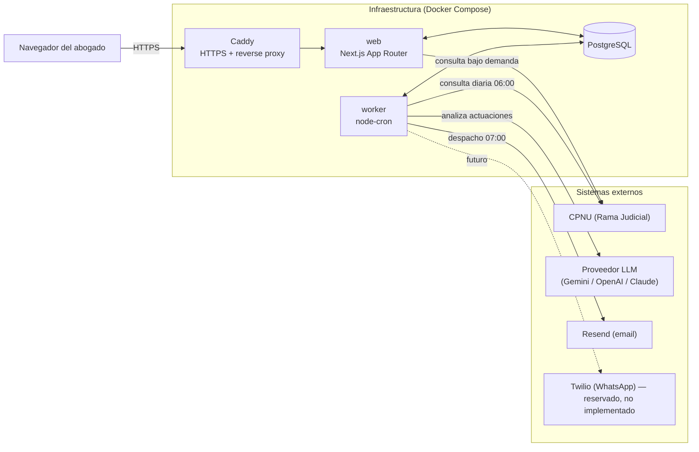
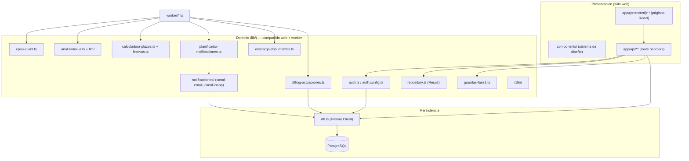
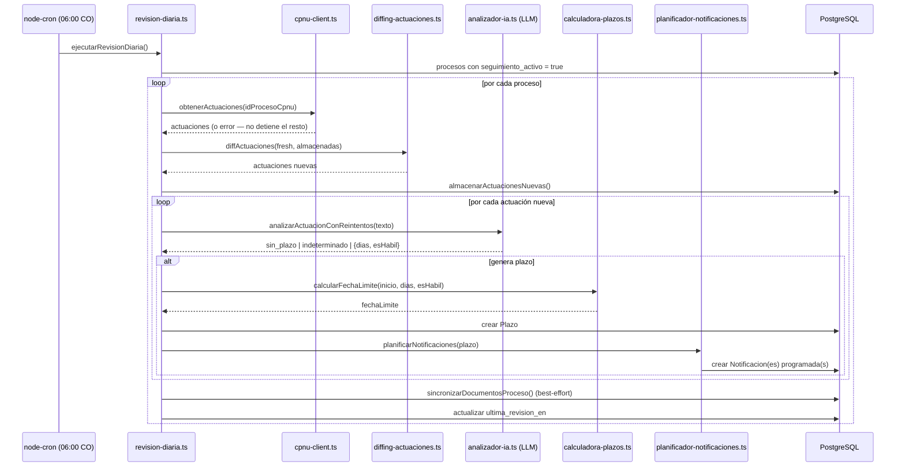
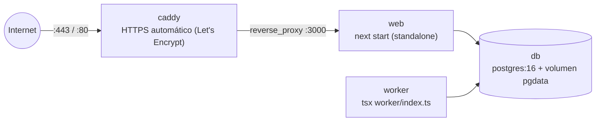

# Arquitectura — LexAI

Este documento describe cómo están organizados los procesos, capas y flujos de datos de LexAI. Para el detalle archivo por archivo (módulos, funciones y clases exportadas) ver [modulos.md](./modulos.md). Para el modelo de datos completo ver `prisma/schema.prisma` (resumido también en modulos.md).

## Visión general

LexAI son **dos procesos Node.js independientes que comparten la misma capa de dominio (`lib/`) y la misma base de datos PostgreSQL**:

- **`web`** — aplicación Next.js 16 (App Router): UI del abogado (tablero Kanban, detalle de proceso, notificaciones, configuración) + rutas API.
- **`worker`** — proceso `node-cron` de larga duración: revisión diaria de procesos contra la CPNU y despacho de notificaciones programadas.

Ambos procesos importan directamente los mismos módulos de `lib/` (no hay una API interna entre ellos): `lib/db.ts`, `lib/cpnu-client.ts`, `lib/analizador-ia.ts`, `lib/calculadora-plazos.ts`, `lib/planificador-notificaciones.ts`, `lib/notificaciones/`, etc. Esto es deliberado: en el MVP no hay cola de mensajes ni microservicios — la "integración" entre web y worker es la base de datos.

## Capas dentro de cada proceso

## Flujo de negocio principal (pipeline de revisión diaria)

El corazón funcional del sistema corre en `worker/revision-diaria.ts`, orquestado por `worker/index.ts` vía cron (06:00 America/Bogotá, solo días hábiles):

A las 07:00 CO, `worker/despacho-notificaciones.ts` busca las `Notificacion` con `estado = programada` y `fecha_programada <= ahora`, y las envía por cada canal activo del usuario (`CanalInApp`, `CanalEmail`; WhatsApp reservado en el esquema pero sin canal implementado), con reintentos por canal y aislamiento total entre canales (el fallo de uno no bloquea los demás).

Por el lado web, `GET /api/procesos` y `GET /api/procesos/:id` llaman primero a `lib/transicion-vencido.ts` (`marcarPlazosVencidos`) para mover a `vencido` cualquier plazo cuya `fecha_limite` ya pasó — esta transición ocurre "al leer", no solo por cron, para que el tablero siempre refleje el estado real incluso si el worker no ha corrido.

## Principios de diseño que atraviesan el código

- **`Result<T, E>` en vez de excepciones** (`lib/repository.ts`): casi toda la capa de dominio devuelve `{ok: true, value}` o `{ok: false, error}` en vez de lanzar. Esto hace que los fallos externos (CPNU caída, LLM con rate limit, SMTP fallando) sean datos explícitos, no control de flujo implícito.
- **Resiliencia por aislamiento**: un fallo en un proceso judicial, una actuación, un canal de notificación o un documento nunca detiene la revisión de los demás (`worker/revision-diaria.ts`, `worker/despacho-notificaciones.ts`). El sistema está diseñado para degradar de forma local, no global.
- **Proveedor de IA intercambiable** (`lib/llm/`): `analizador-ia.ts` solo conoce la interfaz `AdaptadorLLM`; el proveedor real (`gemini`, `openai`, `claude`/`anthropic`, o `mock` en tests) se resuelve una sola vez en `lib/llm/index.ts` según `LLM_PROVIDER`/`LLM_API_KEY`. Cambiar de proveedor de IA no toca ninguna lógica de negocio.
- **Todo en zona horaria de Colombia** (`lib/formato.ts`): el tipo `FechaCO` y las utilidades asociadas evitan que cálculos de plazos, festivos y horarios de cron queden expuestos a bugs de zona horaria del servidor.
- **Guardas de alcance de Fase 1** (`lib/guardas-fase1.ts`): en vez de dejar código muerto o comentado para funcionalidad de Fase 2 (multi-tenant, roles, tutelas, redacción con IA), existen funciones que rechazan explícitamente esas operaciones con un error tipado, documentando y testeando el límite de alcance del MVP. El plan de extensión aditiva está en [extensibilidad-fase2.md](./extensibilidad-fase2.md).
- **Inyección de dependencias para testabilidad**: funciones centrales como `ejecutarRevisionDiaria`, `ejecutarDespacho` o `planificarNotificaciones` reciben sus dependencias (cliente Prisma, cliente CPNU, reloj, funciones de análisis) como parámetros opcionales, permitiendo testear la orquestación completa sin red ni base de datos real.
- **Accesibilidad como requisito, no extra**: el sistema de diseño (`components/`) implementa manejo de foco, roles ARIA, drag-and-drop accesible por teclado en el Kanban, y distinción de estado por texto+ícono+color, no solo color.

## Despliegue

El stack de producción son 4 contenedores orquestados por `docker-compose.yml` (ver también la sección "Despliegue" del [README](../README.md#despliegue)):

- **`db`**: PostgreSQL 16 con volumen persistente `pgdata` y healthcheck (`pg_isready`); `web` y `worker` esperan a que esté `healthy` antes de arrancar.
- **`web`** y **`worker`** se construyen desde la **misma imagen Docker** (`Dockerfile`, multi-stage): la etapa `builder` genera el cliente de Prisma y compila Next.js en modo `standalone`; la etapa `runner` final corre como usuario no-root (`nextjs`) y expone el directorio `uploads/` (expediente digital) con permisos correctos. `web` corre `node server.js`; `worker` sobreescribe el `command` a `npx tsx worker/index.ts`.
- **`caddy`**: recibe tráfico en `80`/`443`, obtiene certificado TLS automáticamente para el dominio en `DOMAIN`, aplica cabeceras de seguridad (`X-Frame-Options`, `HSTS`, etc.) y hace proxy a `web:3000`.
- `deploy.sh` automatiza `git pull` + `docker compose up -d --build` + `prisma migrate deploy` para actualizar un servidor ya aprovisionado (pensado para una instancia EC2 t3.small).
